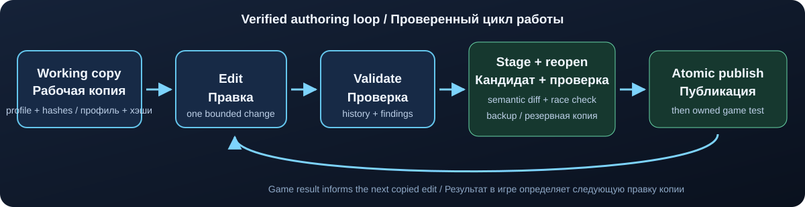
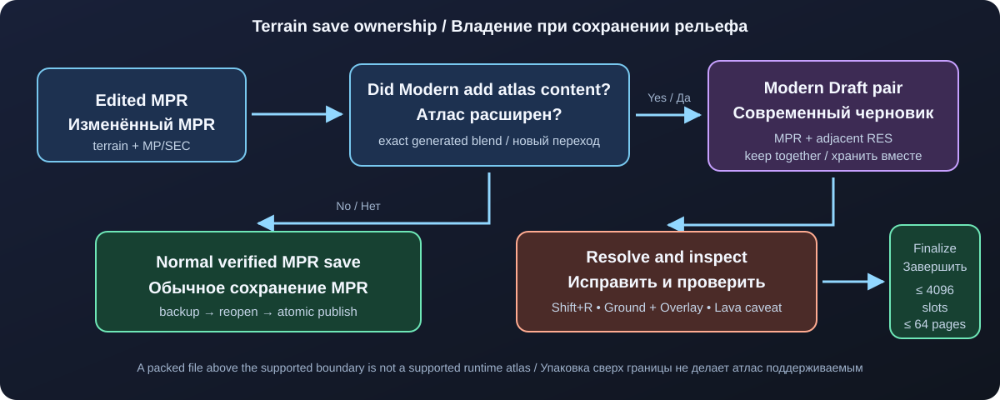

# EI Mapper Endurance User Manual

Version scope: **EI Mapper Endurance 0.5.0-alpha**, repository baseline
`eec794b1aab6df8e187816174bdebc7987e49ce2`.

This is a task-oriented manual for people authoring Evil Islands and Jamais Vu
maps. Menu and button names are written exactly as they appear in the English
interface. The Russian manual has the same sections and anchors.

> **Reading the labels.** **Implemented** describes a normal current workflow.
> **Known limitation** is a boundary you must plan around. **Advanced /
> diagnostic** is a real current feature, but it changes ownership, publishes
> data, or exists primarily to investigate a map; read the whole procedure
> before using it.

## Contents

- [Scope and safety](#scope-and-safety)
- [Documents and ownership](#mental-model)
- [Installation and profiles](#install-and-profile)
- [Interface, maps, creation, and saving](#interface-tour)
- [Viewport and object authoring](#viewport-camera)
- [Behavior, paths, traps, and effects](#behavior-logic)
- [Terrain and materials](#terrain-model)
- [Validation, AI graph, minimap, and testing](#validation-repair)
- [Database and resources](#database-editor)
- [Preferences, shortcuts, and troubleshooting](#preferences-language)

<a id="scope-and-safety"></a>
## 1. Scope and safety

> **Implemented.** Endurance is preservation-first. Opening a supported file is
> inspection, not consent to normalize or repair it. A no-op round trip is
> expected to preserve the original. Changed saves are staged, reopened,
> checked, backed up, and only then published atomically.

Work on a copy of a map or on a mod-owned destination. Do not point a generic
resource mutation at a base-game archive. Keep MPR, all related MOB files,
`map.txt` registration, graph, scripts, and any mod RES overrides together when
you make a test copy; a map is a collection, not one file.

The safest authoring loop is:

1. Select the correct resource profile before opening the map.
2. Open the collection and confirm which MOB is active and editable.
3. Make one logically bounded change.
4. Review validation and the history description.
5. Save explicitly; do not treat autosave as publication.
6. Reopen or use the editor's verified save path, then test through **Test
   Current Map** on a copied/mod-owned map.
7. Keep the backup generation until the game-side result is accepted.



Endurance deliberately refuses operations when source identity, archive
ownership, a required runtime dependency, or a fresh reopen cannot be proven.
That refusal is a safety result, not a request to bypass the check.

<a id="mental-model"></a>
## 2. Documents and ownership

The editor presents one workspace, but the game data has several independent
owners:

| Owner | What it contains | What saving it does not imply |
|---|---|---|
| MPR with MP/SEC members | Terrain heights, land/overlay tiles, MPR material and animation records, `maxZ`, dimensions | Does not save MOB objects, register the map, or necessarily publish a modern working atlas |
| Primary MOB | World objects, units, scripts, diplomacy/world values, often an embedded AI graph | Does not save terrain or supplemental MOBs |
| Supplemental/AutoZone MOB | Additional objects belonging to the same map family | Is not automatically the primary map owner |
| `map.txt` catalog entry | Zone-to-MPR/MOB relationship, entrances, minimap/objectives names, map type | Does not contain the map geometry |
| External `.grp` | Runtime AI graph beside the active MPR | Is ignored when the primary MOB owns an embedded graph |
| RES archives and profile | Textures, models, animations, sounds, database and priority order | A lower-priority member can be present but overridden |
| `database.res` | Relational prototypes and game data | Is protected from generic RES editing |

Always ask two questions before saving: “Which document is dirty?” and “Which
file currently owns this runtime data?” The **Loaded Map** tree, active-MOB
indicator, AI graph source button, minimap source, and Resource Browser provider
chain answer those questions.

<a id="install-and-profile"></a>
## 3. Installation, first run, and profiles

> **Implemented.** The distributed application is portable. Keep its folder
> intact and start `EIMapperEndurance.exe`. Do not copy only the executable;
> Qt libraries, plugins, translations, and runtime helpers belong to the same
> package.

On first run, **Game and Mod Setup...** asks for an Evil Islands installation and
profile. Select the folder containing the expected `game.exe`, then review the
detected resource and map roots before applying it.

The built-in profiles are deliberately separate:

- **Jamais Vu (JMV)** resolves mod resources before Base resources and mod maps
  before Base maps. Use it for Jamais Vu authoring and runtime testing.
- **Base game only** resolves only the Base game roots. Use it for Base content;
  do not rely on JMV overrides being absent merely because a filename matches.

The profile is part of document identity. It determines which same-named
resource wins, which `database.res` is active, which models and texture pages
can be previewed, and whether **Test Current Map** has a supported runtime. If a
map looks wrong, verify the profile before editing fields to compensate.

Use **Settings...** to review the configured paths later. Advanced legacy
figure/texture paths exist for controlled compatibility work; ordinary Base or
JMV projects should remain on their validated profile providers. External
profile JSON is an advanced deployment mechanism, not a per-map shortcut.

<a id="interface-tour"></a>
## 4. Interface tour

The center is the 3D viewport. The normal surrounding tools are:

- **Loaded Map** — MPR, loaded MOB files, active/editable ownership, collection
  context, and map-level commands.
- **Object Outliner** — searchable/filterable object list synchronized with
  viewport selection.
- **Object Properties** — typed fields for the current object or compatible
  multi-selection.
- **Landscape Tools** — sculpt, land painting, overlay work, MPR materials and
  atlas actions. The default shortcut is `Ctrl+L` (older manuals used `B`).
- **MOB Family Validation** — full findings across the loaded family with
  navigation to identifiable objects.
- **Resource Browser** — profile/archive provenance, search, preview, export,
  and reviewed resource transactions.
- **Message Log** — user-relevant messages plus technical evidence. Detailed
  serialization and runtime telemetry may remain English.
- **Visuals** — viewport-only visibility, lighting, helper and animation
  channels. It does not delete or rewrite objects.

Docks can be moved, floated, hidden, and reopened from **View**. `F11` maximizes
the viewport and `F12` toggles full screen. Closing a dock is not deleting its
document.

<a id="maps-and-collections"></a>
## 5. Open maps and collections

Use **Open MPR...** (`Ctrl+Shift+O`) for terrain and **Open MOB(s)...**
(`Alt+Shift+O`) for one or more object documents. The general open command
(`Ctrl+O`) accepts supported map documents. Opening only an MPR is useful for
terrain inspection, but collection-dependent features will report what is
missing.

When several MOB files are loaded, exactly one is the active edit target.
Other MOBs remain visible for context but are locked against accidental edits.
Select the intended active MOB before creating, pasting, deleting, editing
diplomacy, or saving **active MOB**. **Save all MOBs** is explicit and does not
mean “save everything in the workspace”; save the MPR separately.

The Maps/Collections browser uses the active `map.txt` catalog to group a
registered MPR, primary MOB, supplemental MOBs, entrances, and metadata. A
loose MPR/MOB pair can still be inspected. Registration is a separate reviewed
catalog operation—renaming a file or creating terrain does not silently change
`map.txt`.

Use **Close All** (`Ctrl+Q`) when changing projects or profiles. Read dirty-file
prompts carefully: terrain and each MOB have independent dirty state.

<a id="create-mpr"></a>
## 6. Create a new MPR

Choose **New MPR from Terrain Template...**. A template is required because it
provides proven MP/SEC structure, atlas identity, material records, and
animation conventions that cannot safely be invented from a blank byte stream.

The creation dialog supports:

1. A template MPR from the intended profile/map family.
2. Width and height from 1 to 32 sectors.
3. `maxZ`, which converts 16-bit raw height to world height.
4. A flat raw height or a grayscale heightmap, with explicit flip and black/
   white endpoint choices.
5. An existing initial atlas slot and rotation.
6. Optional edge tapering.
7. An optional full overlay plane with its own raw height, existing overlay
   atlas tile, rotation, and existing surface-material slot.

Review the candidate location and name. Replacement of an existing destination
uses the backup and atomic-publication path. The freshly created MPR is reopened
and becomes the terrain document.

> **Known limitation.** This command creates terrain only. It does not create a
> primary MOB, entrances, an AI graph, minimap registration, or a `map.txt`
> entry. Create/register those deliberately.

For a grayscale heightmap, remember:

```text
world height = raw height × maxZ / 65535
```

Black and white therefore represent the chosen raw endpoints, not universal
meters. Avoid using an image whose color profile or resampling changed the
intended 16-bit/8-bit values without reviewing the generated terrain.

<a id="create-mob"></a>
## 7. Create a new MOB

Choose **New MOB...**, then choose whether the document is a primary MOB or a
supplemental/AutoZone MOB. Specify a safe new-ID range. For a primary MOB you
may explicitly copy selected script, diplomacy, and world parameters, or start
with a default 32-player non-hostile diplomacy table.

The command creates an empty runtime-valid document and validates it before
publication. An existing destination is backed up; replacing a currently
loaded MOB is refused.

> **Known limitation.** “New MOB” is intentionally not “clone map.” Objects,
> VSS/editor-only directories, embedded AI graph, and collision/history state
> are never copied. Add or copy objects as a separate visible operation and
> regenerate/reassign graph ownership only after the map geometry is final.

For a new collection, a practical order is: create MPR, create primary MOB,
load both, create essential static objects and entrance metadata, register a
copied catalog, validate, then create supplemental MOBs only when their
ownership is actually useful.

<a id="save-backup-recovery"></a>
## 8. Save, backups, autosave, and recovery

The main save commands are **Save active MOB** (`Ctrl+S`), **Save all MOBs**
(`Alt+Shift+S`), and **Save MPR** (`Ctrl+Shift+S`). Use Save As when changing
identity or publishing to a copied/mod-owned location.

A changed save follows this safety pipeline:

1. Prepare a candidate without changing the destination.
2. Serialize and freshly reopen it.
3. Validate structure, semantics, changed scope, and source identity.
4. Create the required pre-save backup.
5. Race-check the destination and publish atomically.
6. Reopen/adopt the published document as the new clean baseline.

If the required pre-save backup fails, the save is refused. Do not disable or
bypass that refusal; fix free space, permissions, or the backup location.

Backups live under `%LOCALAPPDATA%\EI Mapper Endurance\backups` by default.
Use **Tools > Open Backup Folder**. Endurance keeps hash-addressed snapshots on
open, timestamped pre-save generations, and bounded periodic autosaves (the
current retention is 50 pre-save and 20 autosave generations per managed
stream). Periodic autosave is enabled in General settings by default and can be
run immediately with **Autosave Now**.

Autosave does not overwrite the source map. It creates a recovery generation.
After an unclean exit, Endurance reports available generations; it does not
silently replace the source. To recover:

1. Stop editing the questionable source.
2. Open the backup folder and identify the document, timestamp, and generation
   type.
3. Copy the candidate to a new working name/location.
4. Open that copy with the same profile and validate it.
5. Only after inspection, use Save As to make it the intended working file.

Keep related MPR/MOB generations together when the edit spanned documents.
Never assume the newest timestamp across unrelated files is a coherent map
transaction.

<a id="viewport-camera"></a>
## 9. Viewport and camera

Default navigation:

| Input | Result |
|---|---|
| `W` / `S` or Up / Down | Move forward / backward |
| `A` / `D` or Left / Right | Strafe left / right |
| `Q` / `E` | Move down / up |
| hold `Shift` | Double keyboard movement speed |
| middle-button drag | Orbit around the terrain point under the viewport center |
| wheel | Zoom in Free Camera; change height in constrained mode |
| configured modifier + wheel | Change camera speed from 0.1 to 10.0 (default modifier: `Ctrl`) |
| `Ctrl+R` | Reset camera |
| Numpad `.` | Focus the selected object |

Mouse sensitivity, Free Camera, and the camera-speed wheel modifier are in
**Settings...**. Camera moves are editor state, not MOB object transforms.
The minimap can also move the camera pivot in XY; see [Minimap](#minimap).

<a id="selection-transform"></a>
## 10. Selection and transforms

Left-click selects an object; drag an empty-area rectangle for rubber-band
selection. Hold `Shift` to toggle objects in the selection. The Outliner and
viewport stay synchronized. Only objects in the active editable MOB can be
mutated, even when another MOB remains visible.

The transform workflow is modal:

- `G` — move, initially in the XY plane.
- `R` — rotate, initially about Z.
- `T` — scale.
- `X`, `Y`, or `Z` — constrain to one axis.
- `Shift+X`, `Shift+Y`, or `Shift+Z` while moving/scaling — exclude that axis
  and work in the other two-axis plane.
- Type a signed decimal value for an exact amount; Backspace edits the value.
- Left-click or `Enter` accepts. `Esc` cancels and restores the starting state.

Inspect the status message and properties after a numeric transform. Rotation
and scale operate on the selected objects' current transform context; a visual
helper or particle billboard is not necessarily the object's collision volume.

<a id="history-clipboard"></a>
## 11. History, clipboard, duplication, and visibility

Use `Ctrl+Z` / `Ctrl+Y` for undo/redo and `Ctrl+H` for the history window.
Object edits, terrain strokes, compatible property edits, selected repair
operations, and many tool actions produce descriptive history records.

Standard clipboard commands work for supported object records. `Ctrl+D`
duplicates the selection. A duplicate or pasted group enters pending placement:
move it in the viewport and click to commit. `Esc`, a repeated create/paste
command, or changing context cancels the unfinished placement. A committed
group creates one final undo entry.

`H` hides selected objects in the editor and `Alt+H` unhides. `Delete` removes
supported selected objects from the active MOB. Hiding is relevant to generated
minimap capture; it is not the same as deleting. `U` unloads the active
document through the current context—save or discard prompts still apply.

> **Known limitation.** Undo is document editing history, not a rollback system
> for publication. Saving establishes a clean baseline. **Bake into Primary
> MOB** and **Switch MOB to External .grp** save immediately and cannot be
> reversed with **Edit > Undo**; restore a backup if ownership was committed in
> error.

<a id="outliner-properties"></a>
## 12. Object Outliner and Object Properties

Use **Object Outliner** to search a large map, filter by family/type/loaded MOB,
and select without finding a tiny helper in 3D. Selection changes the
**Object Properties** model and, where possible, the current object highlight.

Properties expose established typed fields. Unknown or preservation-only
values are not relabeled with guessed meanings. For multi-selection, only
compatible shared fields are safely editable; review the scope message before
applying a value.

The most important common groups are identity/class, transform, model, script,
parent/ownership, rendering/collision flags, and type-specific fields. Raw
resource names and serialized tokens may remain English even in the Russian UI
because changing them would change game data.

When a property seems to have no visible effect:

1. Confirm the object belongs to the active MOB.
2. Confirm **Visuals** has the relevant object/effect/helper channel enabled.
3. Confirm a database-prototype value is not currently selected instead of a
   MOB override.
4. Validate the model/resource through the active profile.
5. Use **Test Current Map** for behavior that the editor intentionally only
   approximates.

<a id="object-authoring"></a>
## 13. Static and dynamic objects

Press `Ctrl+N` to create an object through the current creation UI. Choose the
correct family and active MOB, then place it in the viewport. Static scenery,
levers, torches, trap locators, lights, sounds, and particles are grouped
separately from dynamic units/equipment in rendering and validation.

For copied/duplicated objects, Endurance preserves supported fields and unknown
payloads, but identity must remain valid in the whole loaded MOB family. Do not
hand-type an ID merely because it is unused in the active file; supplemental
MOBs can occupy the same family range. Run validation after structural edits.

Treat script/model/parent references as data, not labels. Renaming a resource or
object does not prove that opaque scripts and binaries were rewritten. The
explicit collision repair assistant similarly does not guess script or
`ParentID` references.

For static world geometry, check both visual and navigation consequences:
rendered FIG parts can contribute AI collision; current visible model parts,
pose, scale and rotation affect regenerated graph diagnostics.

<a id="units-equipment"></a>
## 14. Units, equipment, and model parts

Units combine a database prototype with MOB-owned overrides. **Use MOB unit
values** determines whether editable MOB values replace prototype-derived
values for the supported fields. Review which side owns a value before tuning
it; editing the database prototype can affect every user, while a MOB override
is local to that object.

Equipment and character appearance resolve through the active profile. The
unit texture/character preview helps inspect the selected assembly, complexion,
parts, and animation, but gameplay remains authoritative for scripts and combat
logic.

The model-parts list is an inclusion set. Select only compatible authored parts
for the chosen assembly. A blank list has special runtime meaning:

> **Known limitation.** An empty model-parts list enables all parts. On models
> with mutually incompatible or unexpected parts—especially units—this can
> render incorrectly or crash the game. Do not clear the list as a way to hide
> the model; use a proven set or an appropriate editor visibility control.

After changing a unit, validate the NID, prototype, model, equipment references,
logic slots, and any patrol/look records. Test combat/AI behavior in a copied
runtime session rather than inferring it from idle animation.

<a id="behavior-logic"></a>
## 15. Behavior mode, logic slots, and diplomacy

Use `Ctrl+Tab` to switch between Object and Behavior mode. Behavior mode makes
unit logic, paths, look records, traps and related helpers the authoring focus.

Every unit can carry five logic slots:

| Slot | Typical ownership |
|---|---|
| Logic 0 | Default behavior used without an alarm override |
| Logic 1–4 | Behavior selected by the corresponding world alarm state |

Edit the intended slot; a correct Patrol in Logic 0 does not repair an Alarm
Guard configuration in Logic 3. Current behavior choices include **Stay**,
**Guard area**, **Patrol**, **Sentry**, **Player/script controlled**, and
**Alarm guard**, with established aggression and distance/timing fields.

The diplomacy table belongs to a MOB. Values are directional: the row group
acts toward the column group. `0` is Ally, `1` Neutral, and `2` War. The
reciprocal-edit option is explicit because asymmetric diplomacy is valid and
must not be silently “fixed.” Self-relations and asymmetry are preserved with
warnings when unusual.

For a magic trap, **Will attack...** is a read-only preview derived from the
trap's Player group and the containing MOB's current diplomacy. It lists War
targets; it is not a separate target list to edit.

<a id="patrol-look-traps"></a>
## 16. Patrols, look points, levers, and traps

Patrol and look records belong to a particular unit logic slot. Select the unit
and slot first, then add/edit points in Behavior mode. Keep point order visible
and avoid coincident points unless the script genuinely expects them.

Look-point waits are stored in game ticks: **15 ticks = 1 second**. Turn speed
and flags are stored values, not degrees-per-second inferred by the viewport.
Use gameplay testing for exact pacing.

For levers, review state, usable/locked behavior, script hooks, and **CalcGraph**.
Enable graph recalculation when changing the lever state changes passability;
do not use it as a generic visual refresh flag.

Magic-trap **Cast interval** is also in ticks (15 = 1 second). **Cast once** is
the separate boolean ownership. Review spell, activation radius/shape, player
group, nearest-unit behavior, and diplomacy-derived targets together. Do not
copy older third-party labels that describe the interval as a floating-point
reload value.

Floor traps, guard points, torches, and other behavior objects have their own
typed property groups. Keep helper visualization enabled while positioning
them, then check the effect/object channels separately so a hidden helper is
not mistaken for a missing runtime effect.

<a id="lights-particles-sounds"></a>
## 17. Lights, particles, and sounds

Lights expose established color, range, intensity and related fields. Scene
lights can be disabled in **Visuals** or Render settings without altering the
MOB. Compare **Unlit**, **Simple**, and **Full environment** before deciding a
light record is broken.

Particle objects have a helper/locator and a particle visual. **Object helpers**
controls placement aids; **Particle visuals** controls the rendered effect.
**Freeze animations** freezes supported preview animation without changing its
serialized timing.

Sounds likewise combine a positioned object/helper with a resource resolved
through the current profile. The Resource Browser can preview supported audio
when the deployed multimedia backend can decode it; export remains available
when preview decoding is unavailable. Game attenuation, looping and script
activation must be tested in the runtime.

Keep effect locators in the correct active MOB and give them family-unique IDs.
Do not use hide/unhide as a substitute for changing runtime flags unless the
desired change is specifically editor/minimap visibility.

<a id="visual-channels"></a>
## 18. Visuals and render channels

The **Visuals** panel has **Show all** / **Hide all** plus independent channels
for entrances, object helpers, static objects, dynamic objects, terrain,
overlays, fog, scene lights, terrain shadows, object shadows, skybox, particle
visuals, and animation freeze. Lighting modes are **Unlit**, **Simple**, and
**Full environment**. Time of day is controlled separately and also feeds
supported JMV Test/hot-reload staging.

These controls are diagnostic viewport state. Hiding Terrain does not remove
MPR data; hiding Static objects does not delete MOB records. Entrances and
helpers are editor overlays and do not become game geometry.

> **Known limitation.** Some Full environment channels require the desktop
> renderer and are unavailable under ANGLE. Cave environments suppress the
> skybox. Freeze animation also depends on animation preview being enabled.
> Treat a disabled channel as a renderer/context boundary before editing map
> data to compensate.

Use the channels to isolate a problem: first show the raw terrain and static
geometry, then overlays, helpers, local effects, and environmental lighting.
For final judgment, use the supported game test because the editor is a close
authoring preview, not the engine's complete rendering pipeline.

<a id="terrain-model"></a>
## 19. Terrain data model

An MPR contains MP metadata and SEC sector data. Neighboring sectors share a
fixed terrain lattice: each sector contributes a 33×33 vertex grid while the
next sector begins 32 cells later. Land tiles, optional overlay surfaces,
heights, normals, material references, and atlas slots have different
ownership; painting one does not automatically rewrite the others.

Raw height is unsigned 16-bit and becomes world height through `maxZ`:

```text
world height = raw × maxZ / 65535
```

**MPR Materials...** includes height operations such as offset, flatten, clamp,
and normalize, plus vertical-scale choices. Changing `maxZ` without
requantizing changes world height. “Preserve world height” requantizes raw
values and reports clamping when the new range cannot represent them.

Canvas resize is a structural **Save As** operation for 1–32 sectors. You place
the original tile rectangle within the new canvas. Sector-aligned retained SEC
payloads can remain byte-identical; other offsets are retiled and validated.
Expansion projects the nearest land boundary and invents no overlays. A closed
edge taper is intentionally lossy. An optional companion MOB is always a new
file, shifts object origins, can clip by origin, and omits the stale embedded AI
graph. Registration and minimap publication remain separate.

<a id="sculpt-terrain"></a>
## 20. Sculpt terrain

Open **Landscape Tools**, choose **Sculpt terrain**, and select:

- Raise / Lower — move raw height by the configured step.
- Smooth — blend toward neighboring samples.
- Flatten — move toward one raw target; right-click samples a terrain target.
- Noise — apply a bounded variation.

Left-drag paints one continuous stroke; one completed drag becomes one undo
record. `Alt+Wheel` changes brush radius, `Shift+Wheel` changes strength, and
`Alt+Shift+Wheel` adjusts the mode-specific step/range/flatten target. When the
sculpt tool is active, `Z`, `X`, `C`, and `V` select its four modes.

Watch raw/world height and overlay separation near water, cliffs, sector seams,
and map edges. Land sculpting does not promise that an active overlay surface
follows the land. Use **Sculpt overlay surfaces** for overlay height.

Generated AI graph preview automatically rebuilds after a short quiet period
when that generated source is active. This is diagnostic feedback; the sculpt
stroke itself does not silently publish a graph.

<a id="terrain-paint-modes"></a>
## 21. Modern, Classic Auto, and Manual terrain painting

Choose **Paint land tiles**, then one of three ownership modes:

| Mode | Shortcut | What it owns |
|---|---:|---|
| **Modern (Z)** | `Z` | Paints the selected semantic material, reuses exact authored junctions, and can add an exact missing blend to the working atlas |
| **Classic Auto (X)** | `X` | Automatically chooses only exact tiles already in the current atlas; it never extends the atlas |
| **Manual (C)** | `C` | Writes the selected physical atlas slot and rotation directly |

Left-drag paints. Right-drag samples the nearest semantic material in Modern or
Classic Auto and samples the exact tile in Manual. `Alt+Wheel` changes brush
size. `Shift+Wheel` changes semantic material in automatic modes and rotates
the tile in Manual. Number keys `1`–`8` select physical quick tiles. `M` toggles
main terrain and `O` toggles overlays.

Modern is the normal semantic authoring path when new blend tiles may be
required. Classic Auto is the safest no-atlas-growth path: unsupported
boundaries remain untouched instead of being guessed. Manual is for exact
physical corrections and authored special cases; it can create a visually
inconsistent junction if the chosen slot/rotation does not match its corners.

Do not confuse a semantic material (Ground, Lava, etc.), a physical atlas tile,
and an MPR surface-material slot. They are three different kinds of data.

<a id="overlay-authoring"></a>
## 22. Overlay authoring

Overlays are optional surfaces such as water, lava, or other authored planes.
**Landscape Tools** provides:

- **Paint existing overlays** — change atlas imagery only on cells that already
  have an active overlay.
- **Add / remove overlay surfaces** — add coverage or remove it. Add first
  targets an existing surface context and otherwise projects from land; remove
  affects overlays only.
- **Sculpt overlay surfaces** — edit overlay raw height without sculpting land.

Adding coverage requires both an existing compatible overlay atlas family and
an existing MPR surface-material slot. The atlas tile owns visible texture;
the MPR surface material owns typed liquid/surface rendering properties. Ground
and overlay materials cannot be mixed within one tile.

Removal uses the format's inactive designation and preserves exact undo data.
Overlay sculpting updates active cells and maintains seams/normals, but cannot
invent a missing compatible material family. If added overlay vertices clamp
at MPR `maxZ`, adjust the surface/terrain or vertical range deliberately.

Use `O` and the surface-material slot labels to inspect ownership. A surface
can exist but be hidden by the viewport channel; conversely, a helper outline
does not prove an active serialized overlay exists.

<a id="mpr-materials"></a>
## 23. MPR Materials and flipbooks

Open **MPR Materials...** for MPR-owned surface records. The material table
shows slot, type, usage count, color, opacity, **Illumination**, wave multiplier,
and stored warp speed. One slot can be shared by many overlay cells or texture
families, so an edit to a shared slot changes all its users without changing
their atlas imagery.

Illumination scales the surface material's RGB emission. It is not a “lava
flag”; a lava-looking texture can use a non-emissive material, and another
texture can use an emissive one. Duplicate a slot when users need different
typed properties. Removal is limited to a safe unused tail slot; arbitrary
middle deletion would renumber references.

The same tool edits overlay animation/flipbook records. A flipbook uses a start
atlas slot and a frame count over a contiguous physical range. A zero count
disables it. Runtime-compatible frames must remain contiguous and type/
property-compatible; a requested repack can be refused when that cannot be
proven. A successful repack/remap is one undoable MPR change.

> **Known limitation.** Stored warp speed is preserved and editable as a typed
> record, but confirmed gameplay uses a fixed 0.05 warp rate. The wave
> multiplier affects amplitude/apparent phase. Do not promise arbitrary runtime
> animation speed from the stored field alone.

The tool also exposes advanced resource identity, height operations, vertical
scale, and canvas resize. Change one ownership domain at a time and review the
summary before applying the single history transaction.

<a id="material-atlas"></a>
## 24. Material atlas editor

> **Advanced / diagnostic.** **Material atlas...** edits profile semantic atlas
> metadata: material families, physical slot/corner assignments, page bindings,
> and optional local overrides. It does not paint MMP page pixels, edit MPR
> surface-material records, or infer semantics from a picture.

Use it when a profile lacks a validated mapping or when an intentional mod
atlas needs an explicit local contract. Bind against the exact namespace,
pixel hash, slot count, and page identity. A mapping valid for one same-named
archive is not automatically valid for another provider.

The editor prevents mixing ground/underwater and overlay materials in one
corner contract. Review unassigned/conflicting slots before saving metadata.
Prefer the profile's proven shared mapping; make a local override only when the
map genuinely uses a different atlas.

Texture creation/replacement belongs to a separate resource workflow. MPR
surface type/color/illumination belongs to **MPR Materials...**. Keeping these
three owners separate avoids the most destructive terrain mistakes.

<a id="draft-finalize-resolve"></a>
## 25. Modern drafts, finalization, and Resolve Missing Blends

Plain terrain edits that do not change working-atlas content can use the normal
**Save MPR** path. Modern painting that generated/added atlas content cannot be
stored in an MPR alone. Save As then offers two explicit publication paths:

- **Save as Modern Draft** — writes the paired editable MPR plus adjacent RES
  working atlas. Use it to continue authoring. Keep the pair together.
- **Finalize and Save As** — compacts and publishes a runtime-clean atlas and
  MPR to a final game destination. A currently open draft is not overwritten
  in place by finalization.

Before finalization, use **Resolve missing blends... (Shift+R)** while
**Landscape Tools** is active in a Ground/Overlay paint context. Resolve scans
both ground and overlay junctions, replaces missing or inconsistent cases that
have one supported solution, preserves disputed shared corners, and records
one undoable change. Any required exact tiles remain in the working atlas.



> **Known limitation — exact 0.5 RC ROADMAP wording:**
>
> **Lava + Resolve Blends:** direct Modern painting follows the selected
> Lava material, but **Shift+R** cannot yet preserve one visually consistent
> route owner across every rare connected Lava-on-Water transition without
> regressing ordinary Ground/Overlay repair. The bounded generic resolver is
> retained while this remains under review.

For such a rare Lava-on-Water network, keep a pre-resolve generation, inspect
the entire connected transition after `Shift+R`, and use Manual only for a
deliberate exact physical correction. Do not repeatedly resolve and assume the
last visible tile establishes semantic route ownership.

<a id="atlas-boundaries"></a>
## 26. Terrain-atlas runtime boundary

> **Known limitation.** The current tested and release-supported boundary is
> **4,096 terrain-atlas slots / 64 pages**. The packed format can encode more
> (up to its larger representational ceiling), but sizes above 4,096 are not
> supported for release use. A controlled **8,192-slot** load crashed under
> **32-bit address-space pressure**.

This is a runtime boundary, not merely an editor list limit. Corrected tests
validated 1,024, 2,048, and 4,096 slots. Do not publish an 8,192-slot atlas on
the assumption that successful packing proves game viability. Keep finalization
at or below 4,096 slots and review the page/slot count in the publication
summary.

If growth approaches the boundary, reduce duplicate/unused working content,
resolve only needed transitions, and finalize a copy. Never “fix” the issue by
changing packed indexes without updating every owning MPR cell and page
binding.

<a id="validation-repair"></a>
## 27. Validation and navigation to findings

Open **MOB Family Validation** from the View/Tools workflow after loading the
whole map family. The short warning dialog shows only a few bounded lines; the
panel is the complete report. It is a normal dockable/floating window and can
be reopened after closing.

Findings distinguish blockers, warnings, and verified/diagnostic context. For
an NID-backed row, double-click it or use **Select object in editor**. Endurance
activates and selects the exact loaded object when raw section provenance makes
it unambiguous. It does not guess between duplicate IDs or select an unloaded
object. Context actions also copy a field/path/finding for a report.

Run validation after:

- create, paste, duplicate, delete, or ID-range changes;
- moving objects between MOB ownership contexts;
- behavior/path/trap and diplomacy changes;
- MPR structural resize or companion-MOB generation;
- graph ownership or map-registration changes;
- database/resource publication that changes referenced identities.

**Tools > Review and Repair Object IDs...** is an explicit limited assistant.
It proposes deterministic replacement IDs and applies only selected safe
repairs as one undoable document change. It does not run automatically, repair
range overlaps, infer scripts/`ParentID` references, or coordinate an arbitrary
multi-MOB save cohort. Review every proposal and save all affected documents
deliberately.

Validation is not the game. A structurally valid map can still have bad script
logic, visual composition, or an engine-specific behavior. Use it to prove data
contracts before runtime testing, not to replace that testing.

<a id="ai-graph"></a>
## 28. AI navigation graph: inspect, regenerate, compare, and persist

When a valid embedded graph or exact external sibling `.grp` is available, the
viewport shows the **AI navigation graph** widget. `N` shows/hides the selected
layer. Move the slider through all eight unit-profile layers; profile color
runs purple to green, while graph nodes and isolated warnings remain distinct.

The source button says **Graph: Loaded** or the regenerated equivalent. The
selected source is important: **Test Current Map** and **Hot Reload Map** stage
the graph named on that button.

### Diagnostic regeneration

Choose **Regenerate preview** to build all eight layers asynchronously from the
current canonical terrain, overlay depth/type, terrain traversal policy, and
visible static-object/lever collision proxies. Current transformed FIG parts
and authored navigation bounds are used; dynamic units are not blockers. When
the regenerated source is selected, committed terrain sculpt/history and
relevant object transform changes queue another rebuild after a short quiet
period.

Choose **Diff loaded / regenerated** to compare directional missing/extra
links, changed weights, and node positions. This is especially useful around
cliffs, shallow/deep water, fences, doors, bridges, and profile clearance.

> **Advanced / diagnostic boundary.** The generator is a source-informed
> authoring approximation, not proof of exact game movement. The graph format
> is 2.5D: one XY cell can select one surface, so a bridge deck and simultaneous
> traversable underpass cannot both be represented. Missing authored FIG bounds
> use a conservative rendered-volume fallback and are logged. Compare unusual
> assemblies against the loaded game graph and test movement in game.

### Persistence and runtime ownership

Choose **Bake / Export...** only after selecting the graph source you intend to
publish. Endurance freshly prepares and validates runtime-compatible bytes,
then offers:

| Action | Result |
|---|---|
| **Export Runtime .grp** | Writes/validates the exact sibling `.grp` for the active MPR. If the primary MOB still embeds a graph, that embedded graph shadows the file. |
| **Bake into Primary MOB** | Saves the selected graph inside the primary MOB; it has runtime priority over a sibling `.grp`. |
| **Switch MOB to External .grp** | Validates an already existing exact sibling `.grp`, leaves it unchanged, then removes embedded ownership and saves the primary MOB. Export first if no valid sibling exists. |

Both bake and switch immediately save the primary MOB, include any unsaved MOB
edits in that verified save, create a backup, and establish a new baseline.
They are not undoable through Edit history. The dialog warns when one primary
MOB appears to be shared by several catalog entries—changing embedded ownership
can affect every owner.

Runtime priority is always **primary MOB embedded graph first, then exact
active-MPR sibling `.grp`**. Exporting a file while an embedded graph exists is
useful for preparation/comparison but does not switch runtime ownership.

<a id="minimap"></a>
## 29. Minimap

Once an MPR is loaded, the upper-right viewport minimap can show **Embedded**
or **Generated**. It can collapse to a title bar and has three persisted sizes.
The current perspective camera footprint is a map-clipped white outline. Click
or left-drag across the minimap to move camera XY while preserving the camera's
vertical/orbit state.

**Generated** captures terrain, authored overlay surfaces, and visible static
MOB geometry. It excludes dynamic units, particles, helpers, selection, tile
previews, and grids. It uses deterministic authored-environment diffuse
shading; viewport lighting/time changes do not randomly change the result.
Unlocked generated maps refresh after relevant committed changes. **Regenerate**
refreshes immediately and selects Generated. **Apply & Lock** in the export
window freezes the graded result until **Unlock**.

> **Known limitation.** With no MOB loaded, capture is marked incomplete because
> static collection geometry is absent. Load the appropriate MOB sources for a
> production image. Catalog entries authored as `brief` suppress minimap
> capture, display, staging, and export.

Choose **Export Minimap...** for the modeless review tool. It shows Generated
beside a resolvable Embedded control and provides linked/independent zoom and
pan, Fit, 100%, shading, saturation, contrast, brightness, and hue. Reset
returns to the authored-profile defaults. The generated image follows the
resolved embedded texture's supported square resolution/codec; without one, a
JMV zone defaults to the current JMV export profile. Non-square map content is
kept in its active rectangle instead of being stretched.

Export to a new, copied, or mod-owned RES. Existing-member replacement is asked
only after the archive is inspected and **Export** is pressed. The transaction
stages, reopens, preserves untouched members, optionally backs up, and publishes
atomically. A texture placed only in an editor-local RES cannot be selected as
Embedded until that archive belongs to the active profile.

The export flow can stage the reviewed texture for the next JMV test and can
open Map Catalog Editor with only the minimap field staged. The objectives
texture remains unchanged. Catalog publication still requires its separate
verified Save As.

<a id="test-current"></a>
## 30. Test Current Map and hot reload

**Test Current Map** (`Ctrl+F5`) launches only when the active profile and map
dependencies pass their exact gates. Normally this means a validated MPR,
primary MOB, usable `map.txt` entry and entrance, plus a valid graph. A missing
graph can use the explicit guarded graphless path; a malformed graph that is
present blocks the run.

Before launch, review the selected entrance and optional controls:

- **Go to Entrance** uses a registered entrance.
- **Play from Here** places a temporary editor marker. While placing/moving it,
  terrain sculpt/paint input and brush outlines are suspended so a click cannot
  edit terrain.
- **Godmode**, time override, and supplemental runtime options are available
  only when the current JMV map/runtime/script dependencies support them.

Endurance stages validated run-local copies. Unsaved but valid MPR edits can be
included without changing the source MPR. It stages the selected AI graph and,
when Generated is selected, the owned minimap override. Source maps, installed
resources, starter configuration, registry, and live saves are not the staging
target.

While the owned test is active, `Ctrl+F5` becomes **Hot Reload Map**. Ordinary
MPR/MOB and selected graph/minimap changes reload in the owned process. If atlas
byte identity, page layout, or slot layout changes, Endurance restarts only its
owned test process because safe in-process adoption cannot be proven. Use
**Stop Test** (`Shift+Esc`) to stop that process.

> **Known limitation.** Test Current is fail-closed and profile-specific. A
> loose JMV pair needs a valid Play from Here route and has no invented
> minimap/travel/quest metadata. MPR-only, MOB-only, or ambiguous multi-MOB
> collections are not launchable. A separately started `game.exe` is not owned
> and will not be killed or patched by the editor.

When a test is refused, read the first dependency error rather than copying
files into the installation. Fix profile, map registration, entrance, graph, or
validated runtime component identity in the working copy.

<a id="database-editor"></a>
## 31. Database Editor

Open **Database Editor...** for the active profile's protected relational
archive. The editor covers all 26 physical database tables and every
schema-described field: materials, weapons, armors, unit tables, spells, perks,
prints, quests, acknowledgements, and the remaining public schema.

The grid is lazy and typed. Search, sort, show/reorder/resize/freeze columns,
and keep the literal `#` identity column frozen by default. Settings persist per
editor. A selected row receives a soft highlight.

Editing supports scalar values, fixed strings, lists, bit fields, nested
records, and descriptor-unknown hexadecimal payloads. Long/list values open in
a full line-based editor; grid previews stay compact. Established categorical
values have suggestions without restricting valid mod-specific text.

Established identity-compatible references use searchable pickers. Use
`Ctrl+Enter` or **Open Referenced Row** where offered. Database resource-name
fields can use **Open in Resource Browser** to reveal the exact winning member.
Relationships whose transformation is not proven remain plain editable data.

Clone/Delete, per-document undo/redo, **Pending Database Changes**, cross-table
validation, and the Item/Spell constructors use the same transaction model.
Before publication:

1. Review the pending-change manifest.
2. Resolve identity/reference blockers and understand warnings.
3. Use **Save Database As** for a copied/mod-owned destination or **Apply
   Database** only for an eligible provider target.
4. Let Endurance rebuild from the immutable source, patch the exact physical
   record/field, reopen, validate, back up, and publish atomically.

XLSX export/import covers all 26 tables with EIDB-compatible sheet and `FLD`
identities plus source/profile/schema fingerprints. A stale or mismatched
workbook fails closed. Unchanged import is a verified no-op through the
Endurance contract. Do not assume stock EIDBEditor 1.4.4 understands the newer
embedded-source metadata.

> **Known limitation.** Fields described as `Hex` preserve isolated bytes and
> are editable as hexadecimal, but their game meaning is not claimed. Do not
> assign a semantic label based on a coincidental value. Structured values use
> readable line-based authoring; preserve internal IDs and scalar types shown by
> the editor.

<a id="resource-browser"></a>
## 32. Resource Browser

Open **Resource Browser** from View/Tools. **Active profile** mode indexes the
provider chain in priority order; external archive mode inspects an explicit
RES. Search by logical/archive name, filter type, and filter **Winning** versus
**Overridden**. The selected item shows the active/lower provider chain.

Supported previews include images/text, models with part selection and
available animation clips, and audio when the multimedia backend can decode it.
Preview decoding is asynchronous. **Export...** writes a selected payload to a
normal file; **Copy Name** preserves the logical identity for use in properties.

Reviewed archive mutations are **Replace...**, **Add...**, **Rename...**, and
**Delete...**. The transaction dialog states the member, target, consequence,
and backup choice, then stages/reopens/race-checks and atomically writes a new or
eligible mod-owned archive.

Safety boundaries:

- Base-installation archives are read-only in generic transactions. Choose a
  copied, new, or mod-owned target.
- `database.res` and `databaseJmv.res` are protected; use **Open in Database
  Editor** for relational work.
- Add checks CP1251 and case-insensitive name collisions.
- Deleting a winning member may expose the next lower provider; the review
  shows that consequence.
- Rename/Delete cannot prove every structured script or opaque binary
  reference. Review those references manually.
- Changing an archive that participates in the active profile refreshes the
  index only after verified publication.

Do not interpret “Overridden” as unused. Another profile, explicit archive
access, or a script can still refer to that physical member.

<a id="preferences-language"></a>
## 33. Preferences, language, and UI scale

Open **Settings...**. Important groups include:

- **General** — log level, undo-history limit, mouse sensitivity, new-ID range,
  diplomacy symmetry default, Free Camera, water display, helper radius,
  language, UI scale, external script editor, reopen-last-session, periodic
  autosave and backup/cache controls.
- **Render** — culling, unit idle animation, VSync (restart may be required),
  FPS cap/counters, fog, scene lights, shadow quality/distance, terrain shadows,
  mipmapping, lighting and environment behavior.
- **Keybindings** — every listed action and the camera-speed wheel modifier.
- **Resource paths / advanced** — legacy figure and texture locations for
  controlled compatibility work.

For Russian, choose **Language** and the Russian interface option, accept the
restart prompt, save/close work, and restart the editor. The UI catalog changes;
map tokens, resource/member names, scripts, paths, serialized enumerations,
workflow logs, headless validation and technical telemetry may remain English.
Do not translate those stored values by hand.

UI scale affects dialogs/docks and input scaling. If controls clip after a
large scale change, restart as requested and reset dock geometry before
assuming a tool is absent.

<a id="shortcuts"></a>
## 34. Default keyboard shortcuts

Bindings are customizable. This table describes the current defaults, not
shortcuts copied from the legacy EI Mapper manual.

| Area | Shortcut | Action |
|---|---:|---|
| File | `Ctrl+O` | Open supported document |
| File | `Alt+Shift+O` | **Open MOB(s)...** |
| File | `Ctrl+Shift+O` | **Open MPR...** |
| File | `Ctrl+S` | **Save active MOB** |
| File | `Alt+Shift+S` | **Save all MOBs** |
| File | `Ctrl+Shift+S` | **Save MPR** |
| Workspace | `Ctrl+Q` | Close All |
| Workspace | `Ctrl+Space` | Maps & Collections |
| Workspace | `Alt+L` | Message Log |
| Edit | `Ctrl+Z` / `Ctrl+Y` | Undo / redo |
| Edit | `Ctrl+H` | History |
| Edit | `Ctrl+A` | Select all in context |
| Edit | `Ctrl+C` / `Ctrl+V` / `Ctrl+X` | Copy / paste / cut supported objects |
| Edit | `Ctrl+D` | Duplicate selected |
| Objects | `Ctrl+N` | Create object |
| Objects | `Ctrl+F` | Select/search by current command |
| Objects | `H` / `Alt+H` | Hide / unhide |
| Objects | `Delete` | Delete selected supported objects |
| Modes | `Ctrl+Tab` | Object / Behavior mode |
| Modes | `Ctrl+L` | **Landscape Tools** |
| Transform | `G` / `R` / `T` | Move / rotate / scale |
| Transform | `X`, `Y`, `Z` | Axis constraint; Shift+axis excludes axis for move/scale |
| Camera | `Ctrl+R` | Reset camera |
| Camera | Numpad `.` | Focus selection |
| Terrain | `Z` / `X` / `C` | Modern / Classic Auto / Manual while painting; sculpt modes depend on active sculpt tool |
| Terrain | `M` / `O` | Main terrain / overlays visibility |
| Terrain | `Shift+R` | Resolve missing blends in the active paint context |
| Graph | `N` | Show/hide current AI graph layer |
| Test | `Ctrl+F5` | Test Current / Hot Reload |
| Test | `Shift+Esc` | Stop owned test |
| View | `F11` / `F12` | Maximize viewport / full screen |
| Cancel | `Esc` | Cancel transform/placement/tool action or clear selection by context |

`Ctrl+M` opens MOB parameters; `Ctrl+Shift+M` opens the embedded script and
`Ctrl+Alt+M` the configured external script workflow. `Ctrl+P` resets supported
logic paths. Some internal telemetry shortcuts exist for developer diagnostics
and are intentionally not part of the normal authoring table.

When an expected shortcut does nothing, focus the viewport/tool, check current
mode, and review Keybindings. Landscape Tools now uses `Ctrl+L`; the historical
`B` shortcut is migrated away unless the user assigns it explicitly.

<a id="troubleshooting"></a>
## 35. Troubleshooting

### A map or object looks wrong

Check, in order: active profile; winning resource provider; active editable
MOB; Visuals channels; MPR versus overlay ownership; database prototype versus
MOB override; then validation. Avoid “correcting” a field until the ownership
mistake is excluded.

### Save is refused

Read the phase in the message/log. Common causes are backup failure, destination
changed since opening, unsupported archive ownership, candidate reopen failure,
semantic mismatch, an incomplete modern draft pair, or unresolved final atlas
junctions. The old destination is intentionally preserved. Free space/permission
problems should be fixed before retrying.

### Terrain finalization is refused

Open Landscape Tools in the relevant paint context, run **Resolve missing
blends... (Shift+R)**, inspect Ground and Overlay, and review atlas counts. Keep
the 4,096-slot/64-page support boundary and the documented Lava-on-Water caveat
in mind. Do not replace a draft's RES independently of its paired MPR.

### Test Current is refused

Use the first dependency finding: profile/runtime identity, MPR, primary MOB,
map registration, entrance, graph, required script, or an already running game.
Do not launch/copy into a live install to evade the gate. The test-run folder
and `workflow.log` record staged ownership and cleanup.

### The editor closed unexpectedly

Restart, note the recovery notice, use **Open Backup Folder**, and recover to a
new copied name as described in [Save, backups, autosave, and recovery](#save-backup-recovery).
Do not overwrite the source with an autosave merely because it is newest.

### Reporting a bug

Include Endurance version, profile type, exact repeatable steps, expected versus
actual result, whether the source was copied, relevant file hashes, validation
finding, and the smallest relevant log excerpt. `workflow.log` can expose local
paths; crash dumps can contain source/map memory and are private. Redact account
names and private roots. Do not attach copyrighted maps, RES archives, binaries,
or private source unless the owner explicitly authorizes the exact transfer.

<a id="safe-authoring"></a>
## 36. Safe authoring practices

Use this checklist before a substantial edit or publication:

- Work on copied/mod-owned targets; keep live game and proprietary corpus
  read-only.
- Record the profile, source hashes, and collection membership.
- Load the whole relevant MOB family before assigning IDs or validating.
- Confirm the active MOB and data owner before create/paste/delete.
- Preserve unknown fields; do not normalize values whose meaning is uncertain.
- Keep modern draft MPR and adjacent RES together.
- Keep final atlases at or below 4,096 slots / 64 pages.
- Treat resource priority and database prototypes as shared-impact operations.
- Review validation and history after each bounded change.
- Save through the verified path, retain the backup, and reopen/test the
  published copy.
- Test gameplay behavior, AI movement, scripts, audio, particles, and final
  rendering in the supported owned runtime; editor preview is not final proof.
- Preserve logs/hashes but redact paths and never redistribute proprietary
  payloads as “evidence.”

If two documents must change together, write down the cohort before saving.
Endurance protects each publication, but an author can still pair MPR revision
A with MOB revision B by choosing the wrong files afterward.

<a id="limitations-diagnostics"></a>
## 37. Capability labels and current boundaries

The manual uses three labels deliberately:

- **Implemented** — supported in the current UI and normal authoring contract.
- **Known limitation** — implemented around a bounded gap; the stated safe
  workflow is part of using the feature correctly.
- **Advanced / diagnostic** — implemented, but intended for inspection,
  metadata authoring, explicit ownership changes, or expert publication.

Major current boundaries are: atlas release support ends at 4,096 slots / 64
pages; rare connected Lava-on-Water resolve ownership is not fully solved;
regenerated AI graph is still an approximation until explicitly persisted and
game-tested; 2.5D graph cannot represent two traversable surfaces in one XY
cell; MPR-only minimaps omit static MOB geometry; Base archives are protected
from generic mutation; opaque database/resource/script references are preserved
but not invented; and Test Current works only with exact validated profiles and
owned processes.

Unchecked ROADMAP wishes are not capabilities. The current editor does not
promise automatic rewriting of every script/opaque reference, an all-purpose
association editor, arbitrary third-party profile plugins, or private engine
parity.

<a id="terminology"></a>
## 38. Terminology

| Term | Meaning in this manual |
|---|---|
| Active MOB | The one loaded MOB currently allowed to receive object edits |
| Collection / MOB family | Registered or loaded set of MPR, primary MOB, supplemental MOBs, and metadata belonging to one map context |
| MPR | Terrain archive/document, including MP/SEC content |
| Overlay | Optional authored surface above/alongside land, such as water or lava |
| Semantic material | Terrain-paint family/corner meaning used by Modern/Classic Auto |
| Physical atlas slot | Exact packed tile image index and rotation used by Manual/runtime cells |
| Surface material | MPR material-table record referenced by overlay cells; owns typed rendering properties |
| Working atlas / Modern Draft | Editable paired atlas state that may contain generated blends |
| Finalize | Produce a compact runtime-clean MPR/atlas publication |
| Embedded graph | AI graph bytes owned by the primary MOB and given runtime priority |
| External graph | Exact `.grp` sibling of the active MPR, used only when no embedded primary-MOB graph shadows it |
| Winning resource | Highest-priority active-profile provider for a logical resource name |
| Run-local | Temporary, editor-owned test copy; not the source or installed asset |

Russian UI terms are taken from `translations/ei_mapper_ru.ts`, not literally
calqued. Resource names, scripts, file extensions and serialized values remain
as stored. For screens not illustrated here, use the [screenshot checklist](../SCREENSHOT_CHECKLIST.md)
rather than substituting images from the old upstream editor.
