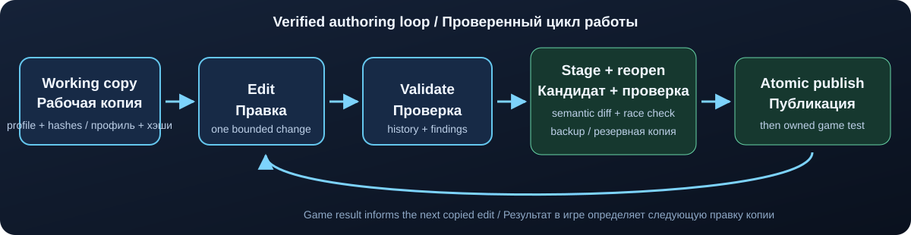
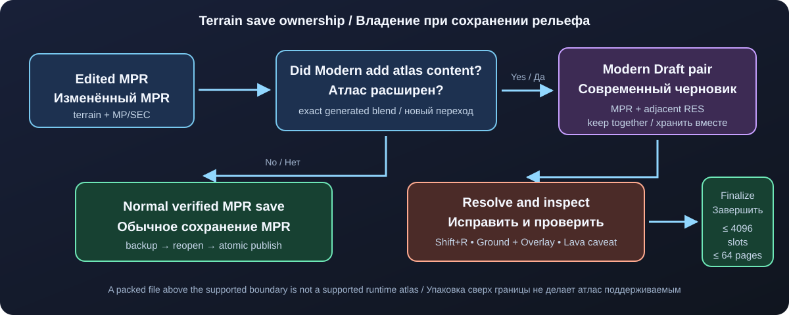

# Руководство пользователя EI Mapper Endurance

Версия: **EI Mapper Endurance 0.3.0-alpha.26**, состояние репозитория
`596327e509f4cee5a4072a5a3a5cda7b425d09bd`.

Это практическое руководство для авторов карт «Проклятых земель» и Jamais Vu.
Названия меню и кнопок приведены в точности по русскому каталогу интерфейса.
Структура разделов и якоря совпадают с английской версией.

> **Как читать пометки.** **Реализовано** — обычная рабочая функция текущей
> версии. **Известное ограничение** — граница, которую необходимо учитывать.
> **Для опытных / диагностика** — реальная функция, но она меняет владельца
> данных, публикует файлы или предназначена прежде всего для исследования.

## Содержание

- [Назначение и безопасность](#scope-and-safety)
- [Документы и владельцы данных](#mental-model)
- [Установка и профили](#install-and-profile)
- [Интерфейс, карты, создание и сохранение](#interface-tour)
- [Камера и работа с объектами](#viewport-camera)
- [Поведение, маршруты, ловушки и эффекты](#behavior-logic)
- [Рельеф и материалы](#terrain-model)
- [Проверка, граф ИИ, миникарта и тест](#validation-repair)
- [База данных и ресурсы](#database-editor)
- [Настройки, клавиши и устранение неполадок](#preferences-language)

<a id="scope-and-safety"></a>
## 1. Назначение и безопасность

> **Реализовано.** Endurance прежде всего сохраняет исходные данные. Открытие
> поддерживаемого файла не означает согласия на его «исправление» или
> нормализацию. Сохранение без правок должно оставлять исходник неизменным.
> Изменённый файл сначала создаётся во временном месте, повторно открывается,
> проверяется и резервируется; лишь затем он атомарно заменяет назначение.

Редактируйте копию карты либо файлы, принадлежащие моду. Не направляйте обычную
операцию над RES в архив базовой игры. При создании тестовой копии держите
вместе MPR, все связанные MOB, регистрацию в `map.txt`, граф, скрипты и RES
мода. Карта — это набор согласованных документов, а не один файл.

Безопасный рабочий цикл:

1. До открытия карты выберите правильный профиль ресурсов.
2. Откройте всю карту и проверьте, какой MOB активен и доступен для правки.
3. Внесите одно законченное по смыслу изменение.
4. Просмотрите проверку и запись в истории.
5. Сохраните явно; автосохранение не является публикацией.
6. Повторно откройте результат или положитесь на проверенный путь сохранения,
   затем запустите копию через **Проверить текущую карту**.
7. Не удаляйте резервную версию, пока результат не проверен в игре.



Если Endurance не может доказать происхождение файла, право на изменение
архива, наличие зависимости или успешное повторное открытие, операция
останавливается. Это защита данных, а не приглашение обойти проверку.

<a id="mental-model"></a>
## 2. Документы и владельцы данных

Редактор показывает единое рабочее пространство, но игровые данные принадлежат
разным файлам:

| Владелец | Что хранит | Чего не означает его сохранение |
|---|---|---|
| MPR и члены MP/SEC | Высоты, тайлы суши и покрытий, материалы и анимации MPR, `maxZ`, размеры | Не сохраняет объекты MOB, не регистрирует карту и не всегда публикует рабочий современный атлас |
| Основной MOB | Объекты, существа, скрипты, дипломатию и параметры мира; нередко встроенный граф ИИ | Не сохраняет рельеф и дополнительные MOB |
| Дополнительный/AutoZone MOB | Другую часть объектов семейства карты | Сам по себе не становится основным владельцем карты |
| Запись `map.txt` | Связь зоны с MPR/MOB, входы, имена миникарты и целей, тип карты | Не содержит геометрию |
| Внешний `.grp` | Игровой граф ИИ рядом с активным MPR | Игнорируется, пока в основном MOB есть встроенный граф |
| RES и профиль | Текстуры, модели, анимации, звуки, базу данных и порядок приоритетов | Низкоприоритетный ресурс может существовать, но быть перекрыт |
| `database.res` | Таблицы прототипов и игровых данных | Защищён от обычного редактирования RES |

Перед сохранением задайте два вопроса: «Какой документ изменён?» и «Какой файл
сейчас владеет этими данными в игре?». Ответ виден в панелях **Загруженная
карта**, активного MOB, источника графа ИИ, миникарты и цепочки поставщиков в
**Просмотре ресурсов**.

<a id="install-and-profile"></a>
## 3. Установка, первый запуск и профили

> **Реализовано.** Готовая сборка переносимая. Не разделяйте её файлы и
> запускайте `EIMapperEndurance.exe` из полного каталога. Рядом должны оставаться
> библиотеки Qt, плагины, переводы и вспомогательные компоненты тестового запуска.

При первом запуске окно **Настройка игры и мода...** просит указать установку
Evil Islands и профиль. Выберите каталог с ожидаемым `game.exe`, затем проверьте
найденные пути ресурсов и карт до применения.

Встроенные профили разделены намеренно:

- **Jamais Vu (JMV)** сначала ищет ресурсы и карты мода, затем Base.
- **Base game only** использует только корни базовой игры.

Профиль — часть личности документа. От него зависят используемый одноимённый
ресурс, активный `database.res`, модели и страницы текстур, а также доступность
**Проверить текущую карту**. Если карта выглядит неверно, сначала проверьте
профиль, а не меняйте поля в попытке подогнать изображение.

Позже пути можно проверить через **Настройки...**. Старые отдельные пути фигур
и текстур предназначены для контролируемой совместимости. Для обычного Base/JMV
лучше сохранять проверенную схему поставщиков. Внешние JSON-профили — средство
развёртывания для опытных пользователей, а не удобный переключатель одной карты.

<a id="interface-tour"></a>
## 4. Основные части интерфейса

В центре находится трёхмерное окно карты. Вокруг него обычно нужны:

- **Загруженная карта** — MPR, загруженные MOB, активный владелец правок,
  контекст набора и команды карты.
- **Иерархия объектов** — поиск и фильтры, связанные с выбором в окне карты.
- **Свойства объекта** — типизированные поля выбранного объекта или совместимой
  группы.
- **Инструменты ландшафта** — правка высот, суши, покрытий, материалов MPR и
  атласа. Текущая клавиша — `Ctrl+L`; старое руководство указывало `B`.
- **Проверка семейства MOB** — полный список проблем с переходом к объектам.
- **Просмотр ресурсов** — источники, приоритет, поиск, просмотр и операции RES.
- **Журнал сообщений** — сообщения пользователю и технические доказательства.
  Подробная телеметрия может оставаться на английском.
- **Отображение** — только видимость и режимы просмотра; объекты не удаляются.

Панели можно перемещать, отделять, скрывать и снова открывать через меню
**Вид**. `F11` разворачивает окно карты, `F12` включает полноэкранный режим.
Закрытие панели не закрывает документ.

<a id="maps-and-collections"></a>
## 5. Открытие карт и наборов

**Открыть MPR...** (`Ctrl+Shift+O`) загружает рельеф, **Открыть MOB...**
(`Alt+Shift+O`) — один или несколько файлов объектов. Общая команда `Ctrl+O`
принимает поддерживаемые документы. Один MPR удобен для исследования рельефа,
но функции, которым нужен весь набор, сообщат о недостающих частях.

При нескольких MOB лишь один является активным назначением правок. Остальные
видны, но защищены от случайной записи. Перед созданием, вставкой, удалением,
редактированием дипломатии и командой **Сохранить активный MOB** выберите
правильный MOB. **Сохранить все MOB** не сохраняет MPR — он сохраняется отдельно.

Окно карт и наборов читает активный `map.txt` и связывает зарегистрированные
MPR, основной MOB, дополнительные MOB, входы и метаданные. Незарегистрированную
пару также можно исследовать. Регистрация — отдельная проверяемая операция:
создание или переименование файла не меняет `map.txt` автоматически.

При переходе к другому проекту/профилю используйте **Закрыть все** (`Ctrl+Q`).
Внимательно читайте запросы: у MPR и каждого MOB своё состояние изменений.

<a id="create-mpr"></a>
## 6. Создание MPR

Выберите **Новый MPR по шаблону рельефа...**. Шаблон обязателен: он даёт
проверенную структуру MP/SEC, личность атласа, записи материалов и анимаций.
Безопасно выдумать их из пустого файла нельзя.

Диалог позволяет задать:

1. MPR-шаблон нужного профиля и семейства карт.
2. Ширину и высоту от 1 до 32 секторов.
3. `maxZ`, связывающий 16-битную сырую высоту с высотой мира.
4. Постоянную высоту или полутоновую карту высот с явным переворотом и
   значениями чёрной/белой точек.
5. Существующий начальный слот атласа и поворот.
6. При необходимости — плавное понижение у края.
7. При необходимости — сплошную плоскость покрытия с отдельной высотой,
   существующим тайлом покрытия, поворотом и материалом поверхности MPR.

Проверьте путь и имя. Существующее назначение заменяется только через резервную
копию и атомарную публикацию. Новый MPR заново открывается редактором.

> **Известное ограничение.** Команда создаёт только рельеф. Она не создаёт
> основной MOB, входы, граф ИИ, миникарту и запись `map.txt`.

Для карты высот действует:

```text
высота мира = сырая высота × maxZ / 65535
```

Чёрный и белый обозначают выбранные сырые границы, а не универсальные метры.

<a id="create-mob"></a>
## 7. Создание MOB

Выберите **Новый MOB...**, затем тип: основной либо дополнительный/AutoZone.
Укажите безопасный диапазон новых ID. Для основного MOB можно явно перенести
нужный скрипт, дипломатию и параметры мира либо создать стандартную
невраждебную дипломатию для 32 групп.

Создаётся пустой, но пригодный для игры документ; до публикации он проверяется.
Существующее назначение резервируется, а замена уже загруженного MOB запрещена.

> **Известное ограничение.** Это не клонирование карты. Объекты, VSS, каталоги
> редактора и встроенный граф ИИ не копируются. Объекты переносите отдельной
> видимой операцией, а владельца графа назначайте после завершения геометрии.

Практический порядок нового набора: MPR → основной MOB → основные статические
объекты и входы → регистрация в копии каталога → проверка. Дополнительный MOB
создавайте лишь тогда, когда его отдельное владение действительно нужно.

<a id="save-backup-recovery"></a>
## 8. Сохранение, резервные копии и восстановление

Главные команды: **Сохранить активный MOB** (`Ctrl+S`), **Сохранить все MOB**
(`Alt+Shift+S`) и **Сохранить MPR** (`Ctrl+Shift+S`). «Сохранить как» применяйте
при смене личности или публикации в копию/каталог мода.

Изменённый документ проходит этапы:

1. Кандидат создаётся без изменения назначения.
2. Он сериализуется и заново открывается.
3. Проверяются структура, смысл, область изменений и исходная личность.
4. Создаётся обязательная резервная копия.
5. Назначение повторно сверяется и атомарно заменяется.
6. Опубликованный файл открывается как новая чистая основа.

Если резервную копию создать не удалось, сохранение запрещается. Исправьте
свободное место, права или путь, а не пытайтесь обойти запрет.

По умолчанию поколения находятся в
`%LOCALAPPDATA%\EI Mapper Endurance\backups`; используйте **Открыть папку
резервного копирования**. Существуют снимки при открытии, версии перед
сохранением и периодические автокопии. Текущие пределы — 50 предсохранений и 20
автокопий на поток документа. Периодическая копия включена по умолчанию; кнопка
**Создать резервные копии сейчас** запускает её немедленно.

Автосохранение не перезаписывает карту. После аварийного выхода редактор лишь
сообщает о доступных поколениях. Порядок восстановления:

1. Не продолжайте править подозрительный исходник.
2. Откройте папку копий и определите документ, время и тип поколения.
3. Скопируйте кандидат под новым рабочим именем.
4. Откройте эту копию с тем же профилем и проверьте.
5. Только после просмотра сохраните её как намеренный рабочий файл.

Если правка затронула MPR и MOB, подберите согласованные поколения. Самые новые
по времени файлы из разных потоков не обязательно образуют одну версию карты.

<a id="viewport-camera"></a>
## 9. Окно карты и камера

| Ввод | Действие |
|---|---|
| `W` / `S` или ↑ / ↓ | Вперёд / назад |
| `A` / `D` или ← / → | Влево / вправо |
| `Q` / `E` | Вниз / вверх |
| удерживать `Shift` | Удвоить скорость клавиатурного движения |
| средняя кнопка + перемещение | Вращать камеру вокруг точки рельефа под центром окна |
| колесо | Приближение в свободной камере; изменение высоты в ограниченном режиме |
| заданный модификатор + колесо | Скорость камеры 0,1–10,0; по умолчанию `Ctrl` |
| `Ctrl+R` | Сбросить камеру |
| `.` на цифровом блоке | Навести камеру на выбранный объект |

Чувствительность, свободная камера и модификатор колеса задаются в
**Настройки...**. Движение камеры не меняет координаты MOB. Камеру можно также
перемещать по миникарте.

<a id="selection-transform"></a>
## 10. Выбор и преобразования

Левая кнопка выбирает объект; протягивание по пустому месту создаёт рамку.
`Shift` добавляет/убирает объект из выбора. Иерархия и окно карты синхронны.
Изменяются только объекты активного MOB.

Преобразование — режим с явным подтверждением:

- `G` — перемещение, сначала в плоскости XY;
- `R` — поворот, сначала вокруг Z;
- `T` — масштаб;
- `X`, `Y`, `Z` — одна ось;
- `Shift+ось` при перемещении/масштабе — плоскость без этой оси;
- число со знаком и десятичной точкой задаёт точное значение;
- левая кнопка или `Enter` применяет, `Esc` отменяет.

После численного изменения проверьте строку состояния и свойства. Видимый
значок частицы или помощник не обязательно совпадает с игровым объёмом объекта.

<a id="history-clipboard"></a>
## 11. История, буфер, дублирование и видимость

`Ctrl+Z` / `Ctrl+Y` отменяют/повторяют, `Ctrl+H` открывает историю. Объекты,
штрихи рельефа, поддерживаемые свойства и выбранные исправления получают
понятные записи истории.

Для поддерживаемых объектов работают `Ctrl+C/V/X`; `Ctrl+D` создаёт копию.
Вставленная/дублированная группа ждёт размещения: переместите её и щёлкните.
`Esc`, повтор команды или смена контекста отменяет незавершённое размещение.
Подтверждённая группа создаёт одну запись отмены.

`H` скрывает выбранное, `Alt+H` возвращает. `Delete` удаляет из активного MOB.
Скрытие влияет на создаваемую миникарту, но не равнозначно удалению. `U`
выгружает активный документ с обычным запросом о сохранении.

> **Известное ограничение.** История не откатывает публикацию. Сохранение
> создаёт новую чистую основу. **Встроить в основной MOB** и **Переключить MOB
> на внешний .grp** немедленно сохраняют MOB и не отменяются через меню
> редактирования; для отката нужна резервная копия.

<a id="outliner-properties"></a>
## 12. Иерархия объектов и свойства

**Иерархия объектов** позволяет искать и фильтровать объекты по семейству,
типу и MOB, не выискивая маленький помощник в 3D. Выбор меняет модель
**Свойства объекта** и подсветку.

Редактор показывает только установленные по смыслу типизированные поля.
Неизвестные значения не получают придуманных названий. Для группы можно менять
лишь совместимые общие поля; до применения проверьте область операции.

Главные группы: личность/класс, преобразование, модель, скрипт, родитель и
владение, флаги отображения/столкновений и поля конкретного типа. Имена
ресурсов, токены и скрипты остаются такими, как сохранены в игре.

Если свойство «не работает», сначала проверьте активный MOB, каналы
**Отображение**, выбор между прототипом базы и значениями MOB, а также
поставщика ресурса. Поведение, которое редактор показывает лишь приближённо,
проверяйте через **Проверить текущую карту**.

<a id="object-authoring"></a>
## 13. Статические и динамические объекты

`Ctrl+N` открывает создание объекта. Выберите правильное семейство и активный
MOB, затем разместите объект. Статические декорации, рычаги, факелы, указатели
ловушек, источники света, звуки и частицы отделены от динамических существ и
снаряжения как в проверке, так и в каналах отображения.

При копировании Endurance сохраняет поддерживаемые и неизвестные поля, но NID
должен быть уникален во всём загруженном игровом семействе. Свободный номер в
активном MOB может уже принадлежать дополнительному MOB. После структурных
правок запускайте проверку.

Ссылки на скрипт, модель и родителя — данные, а не подписи. Переименование
ресурса/объекта не доказывает переписывание непрозрачного скрипта или бинарного
поля. Помощник исправления NID также не угадывает ссылки `ParentID`.

Для статической геометрии оценивайте изображение и навигацию: видимые части FIG,
их поза, масштаб и поворот участвуют в диагностическом пересчёте графа ИИ.

<a id="units-equipment"></a>
## 14. Существа, снаряжение и части модели

Существо сочетает прототип базы данных и локальные значения MOB.
**Использовать значения существа из MOB** определяет владельца поддерживаемых
полей. Изменение прототипа влияет на всех его пользователей, а MOB — только на
этот объект.

Снаряжение и внешний вид разрешаются по активному профилю. Просмотр финальной
текстуры/модели помогает проверить сборку, комплекцию, части и анимацию, но
игровая логика и бой проверяются в самой игре.

Список частей — список включения. Оставляйте лишь совместимые части.

> **Известное ограничение.** Пустой список частей означает «включить все».
> Для несовместимой сборки, особенно существа, это может дать неверный вид или
> сбой игры. Не очищайте список, чтобы спрятать модель.

После изменения проверьте NID, прототип, модель, снаряжение, пять слотов логики
и связанные маршруты/точки обзора.

<a id="behavior-logic"></a>
## 15. Режим поведения, слоты логики и дипломатия

`Ctrl+Tab` переключает объектный режим и режим поведения. У существа пять
слотов логики:

| Слот | Обычное назначение |
|---|---|
| Логика 0 | Основное поведение без тревоги |
| Логика 1–4 | Поведение при соответствующем состоянии мировой тревоги |

Правьте нужный слот: маршрут в Логике 0 не исправит «Стража тревоги» в Логике
3. Доступны установленные типы «Стоять», «Охранять область», «Патрулировать»,
«Часовой», управление игроком/скриптом и «Страж тревоги», а также связанные
поля агрессии, расстояний и времени.

Таблица дипломатии принадлежит MOB. Значение направлено: строка действует по
отношению к столбцу. `0` — союз, `1` — нейтралитет, `2` — война. Обратное
изменение включается явно, поскольку асимметрия допустима и не должна
«исправляться» без спроса.

Для магической ловушки кнопка **Будет атаковать** показывает только группы со
значением «война» в строке группы ловушки. Это производный список, а не ещё
один редактируемый набор целей.

<a id="patrol-look-traps"></a>
## 16. Маршруты, точки обзора, рычаги и ловушки

Маршрут и точки обзора принадлежат конкретному слоту логики существа. Сначала
выберите существо и слот, затем добавляйте точки в режиме поведения. Следите за
порядком и не создавайте совпадающие точки без причины.

Ожидание в точке обзора хранится в игровых тиках: **15 тиков = 1 секунда**.
Скорость поворота и флаги — сохранённые значения; не выводите точное движение
из одной картинки в окне карты.

У рычага проверьте состояние, доступность/запирание, скрипты и **CalcGraph**.
Включайте пересчёт графа, если смена состояния действительно меняет
проходимость, а не как универсальную команду обновления вида.

У магической ловушки интервал применения также в тиках (15 = 1 секунда), а
«однократно» — отдельный флаг. Вместе проверяйте заклинание, область, группу,
выбор ближайшей цели и дипломатию. Старое стороннее описание как вещественной
«перезарядки» неверно.

У напольных ловушек, точек охраны, факелов и других типов свои группы полей.
При размещении включите помощники, а сам эффект проверяйте отдельным каналом.

<a id="lights-particles-sounds"></a>
## 17. Свет, частицы и звуки

У источников света есть цвет, радиус, сила и другие установленные поля. Канал
света сцены можно выключить в **Отображение** или настройках рендера, не меняя
MOB. Сравните режимы без освещения, простой и полный, прежде чем считать запись
сломавшейся.

У частицы отдельно существуют объект-помощник и видимый эффект. «Помощники
объектов» управляют первым, «Частицы» — вторым. Заморозка анимации влияет лишь
на поддерживаемый просмотр.

Звук — позиционный объект плюс ресурс активного профиля. **Просмотр ресурсов**
проигрывает поддерживаемый звук, если системный мультимедийный модуль его
понимает; экспорт доступен и без прослушивания. Затухание, цикл и скриптовый
запуск окончательно проверяются в игре.

<a id="visual-channels"></a>
## 18. Панель «Отображение»

Панель управляет входами, помощниками, статическими/динамическими объектами,
рельефом, покрытиями, туманом, светом сцены, тенями рельефа/объектов, небом,
частицами и заморозкой анимации. Есть команды показать/скрыть всё и режимы
освещения. Время суток задаётся отдельно и передаётся поддерживаемому тесту JMV.

Это диагностика окна карты. Скрытый рельеф не удалён из MPR, скрытый объект не
удалён из MOB, а помощник входа не становится игровой геометрией.

> **Известное ограничение.** Часть полного окружения доступна только в
> настольном рендерере и отсутствует под ANGLE. В пещерах небо отключено.
> Заморозка требует включённого просмотра анимации.

Для поиска проблемы показывайте слои последовательно: рельеф и статическая
геометрия, покрытия, помощники, эффекты, затем окружение. Окончательный вид
проверяйте в поддерживаемом игровом тесте.

<a id="terrain-model"></a>
## 19. Устройство рельефа

MPR содержит метаданные MP и сектора SEC. У каждого сектора сетка вершин 33×33,
а следующий сектор начинается через 32 ячейки: границы общие. Суша, покрытия,
высоты, нормали, материалы и слоты атласа — разные владельцы данных.

```text
высота мира = сырое значение × maxZ / 65535
```

В **Материалы MPR...** есть смещение, выравнивание, ограничение и нормализация
высот, а также изменение вертикального масштаба. Простая смена `maxZ` меняет
мировые высоты. Сохранение высоты мира перекодирует сырые значения и сообщает
об отсечении диапазона.

Размер полотна 1–32 сектора меняется только через «Сохранить как». Исходный
прямоугольник размещается в новой сетке. Выровненные по секторам данные могут
остаться побайтно прежними; прочие смещения перетайливаются и проверяются.
Расширение продолжает край суши, но не выдумывает покрытия. Закрытый край
намеренно вносит потери. Дополнительный MOB всегда создаётся новым, сдвигает
объекты, может отсечь их по точке и не переносит устаревший встроенный граф.

<a id="sculpt-terrain"></a>
## 20. Правка рельефа

Откройте **Инструменты ландшафта**, выберите **Правка рельефа** и режим:

- поднять/опустить;
- сгладить;
- выровнять к целевой сырой высоте (правая кнопка берёт образец);
- шум в заданном диапазоне.

Один непрерывный штрих левой кнопкой — одна запись отмены. `Alt+колесо` меняет
радиус, `Shift+колесо` — силу, `Alt+Shift+колесо` — шаг/диапазон/целевую высоту
по режиму. При активной правке `Z/X/C/V` выбирают четыре режима.

Следите за сушей и покрытием отдельно у воды, обрывов, швов секторов и краёв.
Правка суши не обязана перемещать покрытие; для него есть **Правка покрытий**.

Если выбран созданный граф ИИ, после паузы он диагностически пересчитывается.
Сам штрих не публикует граф.

<a id="terrain-paint-modes"></a>
## 21. Современная, классическая и ручная покраска

Выберите **Рисовать тайлы суши**:

| Режим | Клавиша | Владение |
|---|---:|---|
| **Современный (Z)** | `Z` | Рисует выбранным смысловым материалом, использует точные переходы и при необходимости добавляет точный переход в рабочий атлас |
| **Классический (X)** | `X` | Выбирает только точные тайлы, уже имеющиеся в атласе; атлас не расширяет |
| **Ручной (C)** | `C` | Записывает точный физический слот и поворот |

Левая кнопка рисует, правая берёт образец материала (автоматические режимы)
или точного тайла (ручной). `Alt+колесо` меняет кисть. `Shift+колесо` выбирает
материал либо вращает ручной тайл. `1`–`8` — быстрые физические тайлы. `M`
показывает/скрывает основную местность, `O` — покрытия.

Современный режим нужен, когда допустимо создавать новые переходы. Классический
— безопасный режим без роста атласа: неизвестная граница остаётся как есть.
Ручной годится для точной физической правки, но неверный слот/поворот легко
создаёт несогласованные углы.

Смысловой материал, физический слот атласа и материал поверхности MPR — три
разных понятия.

<a id="overlay-authoring"></a>
## 22. Покрытия

Покрытия — дополнительные поверхности: вода, лава и другие плоскости.
Доступны:

- **Рисовать по существующим поверхностям** — менять атлас только там, где
  покрытие уже активно;
- **Добавлять / удалять поверхности** — создавать или убирать покрытие;
- **Правка покрытий** — менять высоту покрытия, не трогая сушу.

Для добавления нужны существующее совместимое семейство тайлов покрытия и
существующий материал поверхности MPR. Тайлу принадлежит изображение, материалу
MPR — типизированные свойства жидкости/поверхности. Сушу и покрытие нельзя
смешать в одном контракте углов.

Удаление использует штатное неактивное обозначение и сохраняет точную отмену.
Правка высоты поддерживает швы и нормали активных ячеек, но не выдумывает
материал. Если вершины упираются в `maxZ`, осознанно измените поверхность,
рельеф или вертикальный диапазон.

<a id="mpr-materials"></a>
## 23. Материалы MPR и покадровая анимация

**Материалы MPR...** редактирует записи поверхностей, принадлежащие MPR. В
таблице видны слот, тип, число использований, цвет, прозрачность, освещение,
множитель волн и сохранённая скорость искажения. Один слот может использоваться
многими ячейками; его изменение не меняет их атласное изображение.

Освещение масштабирует собственное RGB-свечение материала. Это не «признак
лавы». Если пользователям нужны разные свойства, продублируйте слот. Безопасно
удаляется лишь последний неиспользуемый слот, чтобы не перенумеровать ссылки.

Здесь же редактируются записи покадровой анимации покрытия: начальный слот и
число кадров образуют непрерывный физический диапазон; ноль отключает анимацию.
Кадры должны быть смежными и совместимыми по типу/свойствам. Невозможная
перекомпоновка запрещается; успешное переназначение создаёт одну отменяемую
операцию.

> **Известное ограничение.** Поле скорости искажения сохраняется, но
> подтверждённая игра использует фиксированную скорость 0,05. Множитель волн
> влияет на амплитуду и видимую фазу. Поле не обещает произвольную скорость в
> игре.

Дополнительные вкладки владеют личностью ресурсов, высотами, вертикальным
масштабом и размером полотна. Меняйте одну область владения за раз.

<a id="material-atlas"></a>
## 24. Редактор атласа материалов

> **Для опытных / диагностика.** **Атлас материалов...** меняет смысловые
> метаданные профиля: семейства, физические слоты и углы, привязки страниц и
> локальные переопределения. Он не рисует пиксели MMP, не меняет материалы
> поверхностей MPR и не угадывает смысл по картинке.

Используйте его для атласа мода с явным контрактом или отсутствующей проверенной
привязки. Сверяйте пространство имён, хэш пикселей, число слотов и страницы.
Одноимённый архив другого поставщика не обязан иметь тот же атлас.

Нельзя смешивать материалы суши/подводной части и покрытия в одном угловом
контракте. Проверьте свободные и конфликтующие слоты. Общая привязка профиля
предпочтительнее локальной, если карта действительно не использует другой
атлас.

Создание текстур относится к ресурсам, свойства поверхности — к **Материалы
MPR...**, а смысловая привязка — к этому редактору.

<a id="draft-finalize-resolve"></a>
## 25. Современный черновик, завершение и исправление переходов

Обычная правка без изменения рабочего атласа сохраняется командой **Сохранить
MPR**. Если современная покраска добавила атласные данные, одного MPR
недостаточно. «Сохранить как» предлагает:

- **Сохранить как современный черновик** — записать связанную пару MPR и RES
  рабочего атласа для продолжения работы;
- **Завершить и сохранить как** — собрать компактный игровой атлас и MPR в
  окончательное назначение. Открытый черновик не перезаписывается завершением.

До завершения выполните **Исправить недостающие переходы... (Shift+R)** в
контексте покраски суши/покрытия. Операция проверяет оба слоя, заменяет только
однозначные отсутствующие/несогласованные переходы, сохраняет спорные общие
углы и создаёт одну запись отмены.



> **Известное ограничение 0.5 RC — исходная формулировка ROADMAP:**
>
> **Lava + Resolve Blends:** direct Modern painting follows the selected
> Lava material, but **Shift+R** cannot yet preserve one visually consistent
> route owner across every rare connected Lava-on-Water transition without
> regressing ordinary Ground/Overlay repair. The bounded generic resolver is
> retained while this remains under review.
>
> Перевод: прямая покраска в современном режиме следует выбранному материалу
> Lava, но **Shift+R** пока не может сохранить одного визуально согласованного
> владельца маршрута во всех редких связанных переходах Lava-на-Water, не
> ухудшив обычное исправление суши и покрытий. Пока вопрос исследуется,
> сохраняется ограниченный общий алгоритм исправления.

Для такой сети храните версию до исправления, просматривайте весь связанный
переход и применяйте ручной режим только как осознанную точную правку.

<a id="atlas-boundaries"></a>
## 26. Игровая граница атласа

> **Известное ограничение.** Текущая проверенная и поддерживаемая граница —
> **4096 слотов атласа / 64 страницы**. Упакованный формат способен кодировать
> больше, но размеры свыше 4096 не поддерживаются для выпуска. Контрольная
> загрузка **8192 слотов** завершилась сбоем из-за давления на **32-битное
> адресное пространство**.

Это ограничение игры, а не длины списка редактора. Исправленные испытания прошли
для 1024, 2048 и 4096 слотов. Успешная упаковка 8192 не доказывает пригодность.
Завершайте атлас при 4096 или меньше и проверяйте число страниц/слотов.

При приближении к границе уберите ненужные дубли, создавайте только необходимые
переходы и завершайте копию. Нельзя просто менять упакованные индексы без
одновременного изменения всех ячеек MPR и привязок страниц.

<a id="validation-repair"></a>
## 27. Проверка и переход к проблемам

После загрузки всего семейства запустите **Проверить семейство активного MOB** и
откройте панель **Проверка семейства MOB**. Короткое предупреждение показывает
только несколько строк; полный отчёт находится в панели. Её можно отделить,
закрыть и снова открыть.

По строке с NID дважды щёлкните или выберите **Выбрать объект в редакторе**.
Endurance активирует и выбирает точный загруженный объект лишь тогда, когда его
исходный раздел определён однозначно. При дубликатах или незагруженном MOB
редактор не угадывает. Контекстное меню позволяет скопировать путь или текст
для отчёта.

Проверяйте семейство после:

- создания, вставки, дублирования, удаления и смены диапазонов ID;
- переноса объектов между владельцами MOB;
- правки поведения, маршрутов, ловушек и дипломатии;
- изменения размера MPR и создания связанного MOB;
- смены владельца графа или регистрации карты;
- публикации базы/ресурсов, меняющей используемые личности.

**Просмотр и исправление идентификаторов объектов...** — ограниченный явный
помощник. Он предлагает определённые новые NID и одной отменяемой операцией
меняет лишь выбранные безопасные строки. Автоматически ничего не исправляется;
перекрывающиеся диапазоны, ссылки скрипта/`ParentID` и произвольная группа
сохранения нескольких MOB не угадываются.

Проверка не заменяет игру. Структурно корректная карта может иметь неверный
скрипт, композицию или особое поведение движка.

<a id="ai-graph"></a>
## 28. Граф ИИ: просмотр, пересчёт, сравнение и сохранение

При наличии встроенного или точного внешнего `.grp` появляется виджет
**Навигация ИИ**. `N` показывает/скрывает текущий слой. Ползунок выбирает один
из восьми профилей существ: цвет профиля идёт от фиолетового к зелёному, узлы и
предупреждения об изоляции сохраняют свои цвета.

Кнопка источника показывает **Граф: загруженный** либо созданный граф. Именно
выбранный источник передают **Проверить текущую карту** и **Перезагрузить
карту**.

### Диагностический пересчёт

**Обновить граф** асинхронно строит восемь слоёв по текущему рельефу, глубине и
типу покрытия, правилам проходимости и видимым статическим объектам/рычагам.
Учитываются текущие преобразования и заданные навигационные границы частей FIG;
существа препятствиями не становятся. Если выбран созданный источник,
завершённые правки рельефа и важных объектов запускают новый пересчёт после
короткой паузы.

**Сравнить графы** показывает недостающие/лишние направленные связи, изменённые
веса и положения узлов. Сравнивайте обрывы, воду разной глубины, заборы, двери,
мосты и разные габариты профилей.

> **Для опытных / диагностика.** Пересчёт — приближённая модель для автора, а
> не доказательство точного движения игры. Формат 2,5D хранит одну выбранную
> поверхность в ячейке XY, поэтому настил моста и одновременно проходимый
> тоннель под ним представить нельзя. При отсутствии заданных границ FIG берётся
> консервативный видимый объём и пишется сообщение в журнал. Необычные сборки
> сравнивайте с загруженным графом и проверяйте в игре.

### Публикация и владение

После выбора нужного источника нажмите **Сохранить / экспорт...**. Кандидат
создаётся и заново проверяется, затем доступны:

| Команда | Результат |
|---|---|
| **Экспортировать игровой .grp** | Записать точный соседний `.grp` активного MPR. Встроенный граф основного MOB продолжит его перекрывать. |
| **Встроить в основной MOB** | Сохранить выбранный граф внутри основного MOB; он получает игровой приоритет. |
| **Переключить MOB на внешний .grp** | Проверить уже существующий соседний `.grp`, не менять его, убрать встроенный граф и сохранить MOB. Если файла нет, сначала экспортируйте. |

Встраивание и переключение немедленно сохраняют основной MOB вместе с его
несохранёнными правками, создают резервную копию и новую чистую основу. История
их не отменяет. Если один основной MOB зарегистрирован для нескольких карт,
диалог предупреждает о совместном влиянии.

Приоритет неизменен: **сначала встроенный граф основного MOB, затем точный
соседний `.grp` активного MPR**. Один экспорт не меняет владельца.

<a id="minimap"></a>
## 29. Миникарта

После загрузки MPR миникарта справа сверху показывает встроенный либо
**созданный** вариант. Она сворачивается до заголовка и имеет три сохраняемых
размера. Белый контур показывает пересечение поля зрения камеры с картой.
Щелчок или движение с зажатой левой кнопкой перемещает камеру по XY, сохраняя
её высоту и вращение.

Созданная миникарта включает рельеф, покрытия и видимую статическую геометрию
MOB. Существа, частицы, помощники, выбор, сетка и предварительные тайлы не
попадают в изображение. Используется определённое рассеянное освещение
окружения из MOB; случайная смена вида/часов окна карты результат не меняет.
Разблокированный вариант обновляется после значимых изменений. Обновление
вручную сразу выбирает созданный вариант, а **Применить и заблокировать**
замораживает градацию до команды **Разблокировать**.

> **Известное ограничение.** Без MOB результат помечается как неполный: в нём
> нет статической геометрии. Для готовой миникарты загрузите нужные MOB. Записи
> каталога типа `brief` полностью запрещают создание, показ, тест и экспорт
> миникарты.

**Экспортировать миникарту...** открывает независимое окно. Оно сравнивает
созданное и доступное встроенное изображение, умеет связанный/раздельный
масштаб и панорамирование, «вписать», 100%, освещение, насыщенность, контраст,
яркость и оттенок. Сброс возвращает параметры профиля. Размер и кодек берутся
из поддерживаемого встроенного образца; без него применяется текущий профиль
экспорта зоны JMV. Несquare карта занимает активный прямоугольник без растяжения.

Экспортируйте в новый, скопированный или принадлежащий моду RES. Подтверждение
замены члена появляется только после проверки архива и нажатия экспорта.
Операция сохраняет нетронутые члены, повторно открывает кандидат, при
необходимости создаёт копию и публикует атомарно. Ресурс в локальном архиве
редактора не станет «встроенным», пока архив не входит в активный профиль.

Можно подготовить изображение к следующему тесту JMV и открыть редактор
каталога с изменённым только полем миникарты; поле целей остаётся прежним.
Каталог публикуется отдельной проверенной командой «Сохранить как».

<a id="test-current"></a>
## 30. Проверка текущей карты и горячая перезагрузка

**Проверить текущую карту** (`Ctrl+F5`) запускается только после точных проверок
профиля и зависимостей. Обычно нужны корректные MPR, основной MOB, запись
`map.txt`, вход и граф. При отсутствии графа возможен явно подтверждённый
защищённый запуск без графа; присутствующий, но повреждённый граф блокирует тест.

До запуска выберите:

- зарегистрированный вход;
- «играть отсюда» — временную метку редактора. Во время её установки и
  перемещения кисти рельефа отключаются, чтобы щелчок не изменил MPR;
- Godmode, время и дополнительные параметры — только если текущая JMV-карта,
  среда и скрипт поддерживают их.

Endurance создаёт проверенные временные копии запуска. Допустимые несохранённые
правки MPR могут попасть в тест, не меняя исходник. Передаются выбранный граф и
созданная миникарта. Установленные ресурсы, настройки Starter, реестр и игровые
сохранения не являются назначением этой подготовки.

Во время принадлежащего редактору теста `Ctrl+F5` становится командой
**Перезагрузить карту**. Обычные изменения MPR/MOB, графа и миникарты
подхватываются процессом. Если изменилась личность байтов атласа, страницы или
раскладка слотов, Endurance перезапускает только собственный тестовый процесс.
**Остановить тест** (`Shift+Esc`) останавливает только его.

> **Известное ограничение.** Запуск закрыт при любой недоказанной зависимости.
> Для свободной пары JMV нужен рабочий маршрут «играть отсюда», а миникарта,
> путешествия и задания не придумываются. Один MPR, один MOB без рельефа и
> неоднозначный набор нескольких MOB не запускаются. Чужой `game.exe` редактору
> не принадлежит и не завершается им.

При отказе исправьте первую указанную причину: профиль, регистрацию, вход, граф
или компонент запуска в рабочей копии. Не копируйте файлы в живую установку для
обхода проверки.

<a id="database-editor"></a>
## 31. Редактор базы данных

**Редактор базы данных...** открывает защищённый реляционный архив активного
профиля. Поддерживаются все 26 физических таблиц и все описанные схемой поля:
материалы, оружие, броня, таблицы существ, заклинания, умения, тексты, задания,
реплики и остальные открытые таблицы.

Таблица загружается лениво. Доступны поиск, сортировка, выбор/порядок/ширина и
закрепление столбцов; буквальный столбец `#` закреплён по умолчанию. Настройки
вида сохраняются, выбранная строка мягко подсвечивается.

Редактируются числа, строки фиксированной длины, списки, битовые поля, вложенные
записи и неизвестные дескриптору шестнадцатеричные данные. Длинные значения и
списки открываются в полном построчном поле; в сетке остаётся краткий просмотр.
У известных категорий есть подсказки, но значения мода не ограничиваются ими.

Для доказанных ссылок используются поисковые списки. `Ctrl+Enter` или
**Открыть связанную строку** переходят к цели. Поле имени ресурса может открыть
точного активного поставщика через **Открыть в просмотре ресурсов**. Связи,
преобразование которых не доказано, остаются обычными данными.

Клонирование/удаление, отдельная история, **Неприменённые изменения базы
данных**, проверка между таблицами и **Конструктор предметов и заклинаний...**
используют одну транзакцию. Перед публикацией:

1. Просмотрите список изменений.
2. Исправьте блокирующие личности/ссылки и поймите предупреждения.
3. Выберите **Сохранить базу данных как** для копии/мода либо **Применить базу
   данных** только к допустимому поставщику.
4. Дождитесь минимального исправления неизменяемого исходника, повторного
   открытия, проверки, резервирования и атомарной записи.

XLSX содержит все 26 листов, совместимые имена и поля `FLD`, а также отпечатки
источника, профиля и схемы. Устаревшая/чужая книга запрещается. Неизменённый
импорт должен быть проверенным отсутствием правок. Обычный EIDBEditor 1.4.4 не
обязан понимать новые метаданные встроенного источника.

> **Известное ограничение.** Поля `Hex` сохраняют точные байты, но их игровой
> смысл не заявлен. Не придумывайте назначение по одному значению. Вложенные
> данные редактируются читаемыми строками; сохраняйте показанные внутренние ID и
> типы скаляров.

<a id="resource-browser"></a>
## 32. Просмотр ресурсов

Откройте **Просмотр ресурсов**. Режим **Активный профиль** строит цепочку
поставщиков по приоритету; второй режим читает явно выбранный внешний RES.
Ищите по логическому имени/архиву, фильтруйте тип и состояния **Используется** /
**Перекрыт**. Для выбранного члена показывается вся цепочка.

Поддерживаются изображения/текст, модели с выбором частей и доступных анимаций,
а также звук при наличии декодера. Просмотр идёт в фоне. **Экспорт...** извлекает
полезную нагрузку, **Копировать имя** даёт точное логическое имя.

**Заменить...**, **Добавить...**, **Переименовать...** и **Удалить...** проходят
через просмотренную транзакцию RES. Диалог показывает член, назначение,
последствия и резервную копию; затем выполняет временную сборку, повторное
открытие, сверку гонки и атомарную запись.

Границы безопасности:

- архивы базовой установки доступны только для чтения — выберите копию, новый
  RES или архив мода;
- `database.res` и `databaseJmv.res` открываются в редакторе базы;
- добавление проверяет CP1251 и совпадение имён без учёта регистра;
- удаление используемого члена может раскрыть следующего поставщика;
- переименование/удаление не доказывает исправление всех скриптов и непрозрачных
  двоичных ссылок;
- индекс активного профиля обновляется лишь после проверенной публикации.

«Перекрыт» не значит «никогда не используется»: другой профиль, явное открытие
или скрипт могут обратиться к физическому члену.

<a id="preferences-language"></a>
## 33. Настройки, язык и масштаб интерфейса

В **Настройки...** находятся:

- общие параметры: уровень журнала, предел истории, чувствительность мыши,
  диапазон новых ID, симметрия дипломатии, свободная камера, вода, радиус
  помощников, язык, масштаб UI, внешний редактор скриптов, последний сеанс,
  периодические копии и кэш персонажей;
- рендер: отсечение, покой существа, VSync, ограничение FPS/счётчики, туман,
  свет, качество/дальность теней, тени рельефа, mipmapping и окружение;
- клавиши и модификатор колеса скорости камеры;
- старые пути фигур/текстур для опытной совместимости.

Для русского выберите **Язык**, подтвердите запрос, сохраните работу и
перезапустите редактор. Переводится интерфейс; имена ресурсов, скрипты, пути,
сериализованные значения, журналы, безоконная проверка и техническая телеметрия
могут оставаться английскими. Не переводите эти данные вручную.

После сильного изменения масштаба может потребоваться перезапуск. Если панель
обрезана, сбросьте геометрию окон, а не считайте функцию отсутствующей.

<a id="shortcuts"></a>
## 34. Клавиши по умолчанию

Все назначаемые команды можно изменить. Ниже текущие значения, а не клавиши из
старого руководства EI Mapper.

| Область | Клавиша | Действие |
|---|---:|---|
| Файл | `Ctrl+O` | Открыть поддерживаемый документ |
| Файл | `Alt+Shift+O` | **Открыть MOB...** |
| Файл | `Ctrl+Shift+O` | **Открыть MPR...** |
| Файл | `Ctrl+S` | **Сохранить активный MOB** |
| Файл | `Alt+Shift+S` | **Сохранить все MOB** |
| Файл | `Ctrl+Shift+S` | **Сохранить MPR** |
| Рабочее место | `Ctrl+Q` | Закрыть всё |
| Рабочее место | `Ctrl+Space` | Карты и наборы |
| Рабочее место | `Alt+L` | Журнал сообщений |
| Правка | `Ctrl+Z` / `Ctrl+Y` | Отменить / повторить |
| Правка | `Ctrl+H` | История |
| Правка | `Ctrl+A` | Выбрать всё в текущем контексте |
| Правка | `Ctrl+C/V/X` | Копировать / вставить / вырезать объекты |
| Правка | `Ctrl+D` | Дублировать выбранное |
| Объекты | `Ctrl+N` | Создать объект |
| Объекты | `Ctrl+F` | Поиск/выбор текущей командой |
| Объекты | `H` / `Alt+H` | Скрыть / показать |
| Объекты | `Delete` | Удалить поддерживаемые объекты |
| Режим | `Ctrl+Tab` | Объекты / поведение |
| Режим | `Ctrl+L` | **Инструменты ландшафта** |
| Преобразование | `G/R/T` | Перемещение / поворот / масштаб |
| Преобразование | `X/Y/Z` | Ось; Shift+ось исключает её при перемещении/масштабе |
| Камера | `Ctrl+R` | Сбросить камеру |
| Камера | цифровая `.` | Навести на выбранное |
| Рельеф | `Z/X/C` | Современный / классический / ручной режим; при правке высоты — режим активной кисти |
| Рельеф | `M/O` | Основная местность / покрытия |
| Рельеф | `Shift+R` | Исправить переходы в текущем контексте |
| Граф | `N` | Показать/скрыть слой графа ИИ |
| Тест | `Ctrl+F5` | Проверить / перезагрузить карту |
| Тест | `Shift+Esc` | Остановить свой тест |
| Вид | `F11/F12` | Развернуть окно карты / полный экран |
| Отмена | `Esc` | Отменить преобразование/размещение/инструмент либо очистить выбор по контексту |

`Ctrl+M` открывает параметры MOB, `Ctrl+Shift+M` — встроенный скрипт,
`Ctrl+Alt+M` — внешний редактор; `Ctrl+P` сбрасывает поддерживаемые маршруты
логики. Внутренние телеметрические сочетания намеренно не входят в обычную
таблицу автора.

Если клавиша не действует, передайте фокус окну карты/инструменту, проверьте
режим и назначения. **Инструменты ландшафта** теперь открываются `Ctrl+L`;
историческая `B` не используется, если её не назначили вручную.

<a id="troubleshooting"></a>
## 35. Устранение неполадок

### Карта или объект выглядят неверно

Проверяйте по порядку: профиль; используемого поставщика; активный MOB; каналы
отображения; владельца суши/покрытия; прототип базы против MOB; затем отчёт
проверки. Не «чините» поле, пока не исключена ошибка владения.

### Сохранение запрещено

Прочитайте этап в сообщении/журнале. Причины: ошибка резервной копии, изменение
назначения извне, запрещённый владелец архива, отказ повторного открытия,
смысловое несоответствие, неполная пара черновика или неразрешённые переходы.
Старое назначение намеренно остаётся прежним. Исправьте место и права до повтора.

### Нельзя завершить атлас

Откройте нужный контекст покраски, выполните **Исправить недостающие переходы...
(Shift+R)**, проверьте сушу/покрытия и число слотов. Помните предел 4096/64 и
ограничение Lava-на-Water. Не заменяйте RES черновика отдельно от MPR.

### Не запускается проверка карты

Исправьте первую указанную зависимость: профиль/игровой компонент, MPR,
основной MOB, регистрацию, вход, граф, скрипт либо уже работающую игру. Не
обходите защиту через живую установку. Папка теста и `workflow.log` содержат
сведения о временном владельце и очистке.

### Редактор аварийно закрылся

После перезапуска прочитайте уведомление, откройте папку резервов и восстановите
под новым именем по [разделу о восстановлении](#save-backup-recovery). Не
заменяйте исходник самой новой автокопией без проверки согласованности.

### Отчёт об ошибке

Укажите версию, тип профиля, повторяемые шаги, ожидаемый/фактический результат,
работу с копией, хэши, вывод проверки и минимальный фрагмент журнала.
`workflow.log` раскрывает локальные пути, дамп — память карты и может быть
конфиденциальным. Удалите имена учётных записей и приватные пути. Не прикладывайте
защищённые карты, RES, исполняемые файлы или приватный код без отдельного
разрешения владельца.

<a id="safe-authoring"></a>
## 36. Правила безопасной работы

- Правьте копии/файлы мода; установку игры и исходный корпус оставляйте только
  для чтения.
- Запишите профиль, хэши и состав набора.
- До назначения ID загрузите всё игровое семейство MOB.
- Перед созданием/вставкой/удалением проверьте активный MOB и владельца поля.
- Сохраняйте неизвестные значения; не нормализуйте неясные поля.
- Держите MPR современного черновика рядом с его RES.
- Не превышайте 4096 слотов / 64 страницы в окончательном атласе.
- Считайте порядок ресурсов и прототипы базы изменениями общего действия.
- После каждой законченной правки проверяйте отчёт и историю.
- Сохраняйте проверенным путём, храните резерв и повторно открывайте/тестируйте
  опубликованную копию.
- Поведение ИИ, скрипты, звук, частицы и окончательный рендер подтверждайте в
  принадлежащем редактору игровом тесте.
- Сохраняйте хэши/журналы, но скрывайте пути и не распространяйте защищённые
  данные как «доказательство».

Если должны измениться несколько документов, заранее запишите их состав.
Каждый файл публикуется безопасно, но автор всё равно может позднее соединить
MPR версии A с MOB версии B.

<a id="limitations-diagnostics"></a>
## 37. Пометки возможностей и текущие границы

- **Реализовано** — поддерживаемая функция текущего интерфейса.
- **Известное ограничение** — функция существует, но безопасный порядок из
  руководства является частью её правильного использования.
- **Для опытных / диагностика** — исследование, метаданные, явная смена
  владельца или публикация с широким влиянием.

Главные границы: атлас поддерживается до 4096/64; редкие связанные переходы
Lava-на-Water ещё не имеют полного решения; созданный граф ИИ остаётся
приближением до явной публикации и игры; формат 2,5D не хранит две проходимые
поверхности в одной XY-ячейке; миникарта без MOB лишена статических объектов;
архивы Base защищены; непрозрачные ссылки сохраняются, но не угадываются; тест
работает только с точными проверенными профилями и своим процессом.

Невыполненные пункты ROADMAP не являются функциями. Редактор не обещает
автоматически переписать все скриптовые/двоичные ссылки, универсальный редактор
ассоциаций, произвольные плагины профилей или точное воспроизведение приватного
движка.

<a id="terminology"></a>
## 38. Термины

| Термин | Значение |
|---|---|
| Активный MOB | Единственный загруженный MOB, принимающий объектные правки |
| Набор / семейство MOB | MPR, основной и дополнительные MOB и метаданные одного контекста карты |
| MPR | Документ рельефа, включая MP/SEC |
| Покрытие | Дополнительная поверхность, например вода или лава |
| Смысловой материал | Семейство/значение углов для современной и классической покраски |
| Физический слот атласа | Точный индекс изображения тайла и поворот |
| Материал поверхности | Запись таблицы MPR, на которую ссылается покрытие; владеет свойствами отображения |
| Рабочий атлас / современный черновик | Связанное редактируемое состояние с созданными переходами |
| Завершение | Выпуск компактной игровой пары MPR/атласа |
| Встроенный граф | Граф в основном MOB с высшим игровым приоритетом |
| Внешний граф | Точный `.grp` рядом с MPR, используемый только без перекрывающего встроенного графа |
| Используемый ресурс | Поставщик с наивысшим приоритетом для логического имени |
| Временный файл теста | Копия, принадлежащая Endurance, а не исходнику или установке |

Термины интерфейса проверены по `translations/ei_mapper_ru.ts`, а не переведены
буквально. Имена ресурсов, расширения, скрипты и сериализованные значения
остаются исходными. Для ещё не снятых экранов используйте [список снимков](../SCREENSHOT_CHECKLIST.md),
а не изображения старого редактора.
