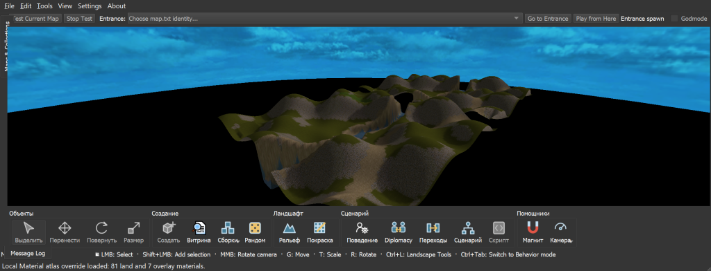
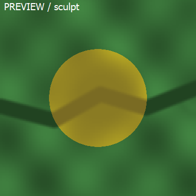

# EI-MCP-EDIT-219 — создание карт агентом, 2026-10-24

Владелец2026-10-24. main, база `b9f38ed0860c6201f081e2c4e155cea2574774ac` /218,
результат219. База131, RecipeBaker/MixedEdge не возвращены. Постоянная218 не
обновлялась, push отсутствует. Код приватного движка не использовался; соответствующие
skills в этой сессии недоступны.

## Результат и безопасность

Режим «Правка» и отдельная галочка «Разрешить агенту сохранять» доступны только
человеку в доке. После нового процесса — Выкл/без Save. Существующие14 инструментов
и MCP2026-07-28/legacy218 сохранены; добавлены create_map, sculpt, paint, preview,
apply, undo_last_agent_operation, save, get_revision. Всего22 инструмента.
[Параметры, примеры и пределы](../AI_AGENT_MCP.md).

Один мост-писатель, остальные могут читать. Подготовка на отделённых снимках:
рабочий поток не содержит CView/MainWindow/QWidget. До принятия кандидата живые
высоты, семантика и атлас не меняются. Перед применением проверяется ревизия
документов/истории/профиля/раскладки/ресурсов и активных текстур. Ручная правка
во время подготовки сохраняется, устаревший кандидат отклоняется. Отмена,
отключение и close211 отбрасывают кандидат, освобождают bounded worker и не
оставляют частичную операцию. Один запрос — одна обычная Undo «ИИ: …», включая
включённых соседей и связанные MOB-высоты. Чужая верхняя команда не отменяется.

Рельеф использует общий алгоритм согласования смещённых стыков131/215 с
дополнительной функцией области; старые вызовы сохраняют прежние значения по
умолчанию. Покраска использует тот же каталог авторских переходов, выбор источника,
рабочий атлас и131 resolver, shared-corner resolution и стыковку по настоящим
пикселям соседа. Подготовленные варианты удерживаются до применения всего региона;
исторические физические слоты не перерабатываются ради агента.

Новая MPR проходит генератор и commit213, сразу получает hash-namespace и атлас
в настроенном HDPack. Только mapRoots активного профиля, без перезаписи, Windows
устройств, произвольных путей и выхода через ссылки. Для начального материала
используется текущий чистый шаблон или доступная исходная MPR материала в mapRoots.
Undo создания возвращает прежнюю карту, сохраняя начальный файл на диске.

Обычные правки остаются в памяти. Save без галочки отклоняется; с ней вызывается
штатный Save209–216 с резервами, cohort guards, публикацией/компактизацией,
commit/readback и пределом126 страниц. Отдельного serializer нет. Нормальная
неделимая файловая стадия завершается до удаления окна. ID отправляется до неё;
мост допускает до30с для опроса только новых edit-ID. У старых чтений/прочих запросов
остался2с deadline, корреляция ID, отбрасывание канала и явный reconnect после таймаута.
Результаты ограничены8/60с, подготовка30с; одновременно один worker правки,
включая ещё освобождаемый после отмены. Максимум4 карты/256 секторов на операцию,
сетка/маска64×64, линия128 точек, область2048м по стороне. Overlay рисуется на
существующей поверхности; создание overlay и placement объектов сюда не входят.

## Сквозная проверка настоящего маппера и моста

[tests/ai_agent_edit_check.cpp](../../tests/ai_agent_edit_check.cpp) связывается с
production Release219, заменяется только runAssemblyCatalogCheck. Настоящие
MainWindow/QGLWidget скрыты WA_DontShowOnScreen; настоящий EIMapperMcp.exe,
stdio/QLocalSocket/QLocalServer, обычные загрузка, preview, Ctrl+Z QAction и Save.
Клавиша Ctrl+Z проверена у штатного действия, которое и выполняет историю.

Финальный [run7](../../build-mcp-edit-219/run7/process.json): **165 PASS,0 FAIL,
exit0,50.047с**; отдельный новый процесс **17 PASS,0 FAIL,exit0,3.672с**.
[Основной stdout](../../build-mcp-edit-219/run7/stdout.txt),
[повторное открытие](../../build-mcp-edit-219/run7/reopen/stdout.txt).

- Read-only отказывает всем новым изменяющим tools; Edit не выдаёт Save.
- Созданы две настоящие MPR4×4 сектора с начальной высотой10м и лугом. Создание
  сразу публикует атлас в private HDPack; существующее имя и ../ отклоняются.
  Undo создания возвращает чистую zone1, Redo открывает новую MPR.
- Настроен штатный общий холст двух новых карт; загружен настоящий background GL
  renderer соседа. Sculpt и Modern paint через стык меняют обе карты одной Undo;
  Undo/Redo возвращают соседний SEC, высоты и семантические углы на границе совпадают.
  Выключение общей кисти сохраняет соседа.
- Холмы с seed219, выравнивание долины, русло-низина по полилинии, smooth через
  preview/apply, билинейная сетка высот и маска. Большая сетка отвергнута до работы.
- Луг с перемешиванием, камень по склонам, лес-подложка, берег, вода и дорога.
  Для каждого применённого запроса проверены одна запись Undo, полное восстановление
  SEC/семантики/пикселей/типов атласа и идентичный повтор с тем же seed.
- Preview не меняет документ. После человеческой команды apply отказывает по
  ревизии. Отдельно человек реально меняет высоту8,8, пока paint готовится в worker:
  кандидат отказывает, ручное значение сохраняется и самостоятельно отменяется.
- Прямое применение возвращает настоящий PNG после операции. Undo last использует
  штатную историю; обычный Redo восстанавливает результат. Второй писатель отклонён.
- Disconnect и cancel во время подготовки сохраняют точный снимок карты и историю;
  worker освобождается. Save без галочки отказывает, с галочкой сохраняет обе карты
  и атласы обычным конвейером, dirty очищен,126 страниц не превышены.
- При следующем процессе режим/галочка снова выключены. Высоты и XY совпали;
  для каждой ячейки совпали пиксели с учётом поворота и runtime type после сохранения
  и компактизации. Карта найдена в private HDPack и открыта настоящим фоновым соседом
  с GL texture array. Закрытие при активной подготовке: view удалён, descriptor
  удалён,211 `Shutdown complete status:clean`, без зависания.

Дополнительный [capabilities3](../../build-mcp-edit-219/capabilities3/process.json):
**32 PASS,0 FAIL,exit0,26.469с**. Начальный материал отсутствует в активном атласе:
create_map выбирает исходную MPR из mapRoots, настоящие четыре угла начального
тайла имеют запрошенный ID. На существующем overlay частной zone1 выполнена
Modern-покраска водой; одна Undo полностью вернула слой и атлас.
После явной человеческой загрузки другого документа тест переподключает мост.

Снимки исходного framebuffer и окна просмотрены; это техническая проверка сцены,
не художественная или игровая приёмка владельца:

## Связанный регресс и незакрытые проверки

[Read-focused](../../build-mcp-edit-219/read-focused/process.json): **536 PASS,
0 FAIL,exit0,12.36с**. Старые read tools/dirty/Undo, авторизация/Off, resource
MCP,8 результатов/expiry/cancel, неправильный/поздний ID, исходный2с timeout,
reconnect и close211 с worker проверены на настоящем219. Счётчики включают
RPC/assertions и опросы, это не536 разных пользовательских сценариев.

Официальный SDK2.3.0, [sdk-final](../../build-mcp-edit-219/sdk-final/result.json):
modern/legacy,22 JSON Schema2020-12,2 resources, ping, отказ неподключённого чтения
PASS. Реальные конфиги уже подключённых владельцем Codex/Claude не редактировались;
новая регистрация и модельные вызовы не выполнялись.

[Регресс общего рельефа](../../build-mcp-edit-219/world-result.txt):40 PASS,0 FAIL,
**5 SKIP** необязательных installed-map cases, без выдачи SKIP за PASS.
Затронутый общий алгоритм также проверен настоящим двухкарточным e2e выше.

Предварительные прогоны сохранены: run1 — ошибка сравнения разделителей в
fixture guard; run2 — собственная публикация не была отмечена наблюдателю;
run3 — завершение создания до готовности canonical model; run4 — повторное
использование ещё не применённых слотов региона. Run5 прошёл153+17 до расширения
ревизии/проверок. Run6 обнаружил гонку отправки ID с файловым commit; исправлены
flush и ограниченный срок edit-poll. Финальный run7 прошёл на итоговых production
объектах. Capabilities2 подтвердил начальный материал, затем потребовал reconnect
после явной ручной загрузки; capabilities3 прошёл полностью.

Исходный полный read-regression драйвер остановлен после181с на неизменённом
диалоге private setup. Это НЕ PASS. Отдельный focused run явно пропустил только
этот не относящийся к задаче диалог настройки218, сохранив все transport/read/close
проверки. Новое owner-driven интерактивное подключение и игровая/ручная приёмка
не выполнялись и не подменяются этими тестами.

## Изоляция, сборка и передача

Каждый e2e имеет собственные game/profile/Maps, копию HDPack, настройки,
AppData/userprofile/temp/backups и агентские каталоги. Игра заменена маркером,
игра и старые мапперы не запускались. Для финального run7 и read-focused **197
живых исходных файлов** дополнительно удерживались Windows read-share handles,
исключающими запись/замену; SHA всех197 до/после совпали. Их приватные пути и
полные receipts остаются вне Git в каталогах проверки. Приоритет и буфер не менялись.
Пользовательские карты, паки и реальные настройки агентов не изменены.

Исключение изоляции: дополнительный standalone world-test по ошибке использовал
системный Temp и оставил только свой каталог
`C:/Users/samol/AppData/Local/Temp/world_terrain_sculpt_tests-KhzuOl` с readonly
синтетическими fixture. Автоматическая проверка отклонила его scoped-удаление:
`blocked by policy`. Каталог оставлен; отсутствие изменений во всём живом AppData
не заявляется. Настройки приложений этот standalone тест не менял.

Release219 собран scripts/build_release.cmd с Qt5.12.12/MinGW7.3 x64,
штатные x86 runtime-компоненты пересобраны из того же git archive.
Production tree `757455b2d69bbdf85b7fb8e66336bf949d75b374`;
проверяется совпадение всех production inputs с итоговым main и архивом.
Сборка: `build-mcp-edit-219/source/build-release-219`.

Передача: свежий `build-mcp-edit-219/build-staging-219-mcp-edit`, мост рядом с
редактором, runtime/QtNetwork/compiler DLL, VERSION219, одна запись CHANGELOG,
инструкция и этот отчёт со снимками. Raw/staged EXE SHA и обе версии проверены
до finalizer; после успешного finalizer комплект не запускается.
[Stage receipt](../../build-mcp-edit-219/stage-receipt.json),
[identity](../../build-mcp-edit-219/source-identity.json),
[commit receipt](../../build-mcp-edit-219/commit-receipt.json).

Scoped-коммит main: только собственные изменения; владельческий хвост ROADMAP
и .mcp.json сохранены побайтно и не входят в коммит. Автор/коммиттер
Codex <codex@localhost>, требуемый Co-Authored-By Claude Opus5.5. Полный итоговый
SHA дан в commit receipt и передаче. Установка218/её135 managed-файлов сохраняются;
СТОП ПЕРЕД УСТАНОВКОЙ, push отсутствует, чужие откаты/артефакты не удалялись.

## Установка219 — 2026-10-24

Владелец принял219 и явно поручил «ставь». Установлен проверенный staging
`build-mcp-edit-219/build-staging-219-mcp-edit` без пересборки;
source main `b1246509662b0574347d6abc98f65d375587d631`.
Постоянный путь: `artifacts/EI-Mapper-Ataman-2-first-test`.

Перед заменой проверено отсутствие EIMapperEndurance и игры. По отдельному
явному разрешению владельца завершён мост EIMapperMcp (PID60332); другие
приложения не завершались. Регистрации MCP, ~/.codex/config.toml и .mcp.json
не менялись; путь EIMapperMcp.exe остался прежним.

Откат218: `artifacts/rollback218-to219-mcp-edit-20261024` — все135 управляемых
файлов218, прежний SHA256SUMS.txt, rollback-state.json и rollback.ps1.
SHA резервных файлов, синтаксис скрипта и его `-VerifyOnly` проверены:
`ROLLBACK_VERIFIED_218`. Прежние и чужие откаты/артефакты сохранены.

По старому/новому manifest заменены9 прежних файлов, добавлены5,
удалён1 устаревший управляемый отчёт218; manifest заменён последним.
Проверки установки PASS:

- установленный `--version`: `EI Mapper Endurance Edition 219`;
- все139 управляемых файлов совпали по SHA256 со staging;
- набор и SHA256 всех16995 пользовательских файлов не изменились.

EXE SHA256: `d1b33cf45941ebedf7dd0b3b0f8c0c4fd02b6ce89d50edbc5d6924abd80fae56`.
Выполнены только порученные проверки установки; `--version` запускался
без окна в изолированном окружении. Финализатор на установке, интерактивный
маппер и игра не запускались. Push отсутствует. Визуальная/игровая приёмка
остаётся за владельцем; прежний раздел «СТОП ПЕРЕД УСТАНОВКОЙ» описывает
состояние подготовки до этого разрешения.

[Installation receipt](../../build-mcp-edit-219/install-receipt.json),
[rollback verification](../../build-mcp-edit-219/rollback-verified.json).
Scoped-коммит установки содержит только эту запись и собственную запись ROADMAP;
владельческие правки ROADMAP и .mcp.json сохранены вне коммита.
